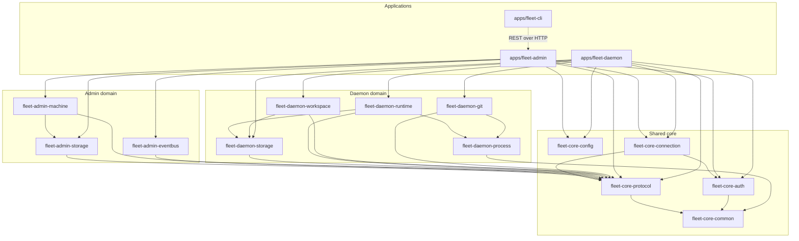

# Fleet

Self-hosted control plane for coding agents running on machines you own — one
web UI for sessions, workspaces, Git, and tool permissions.

## Install

Linux, macOS, and WSL2:

```bash
curl -fsSL https://luozhouyang.github.io/fleet/install.sh | sh
```

Pin a version with `sh -s -- --version v0.1.0`, or choose a prefix with
`--prefix "$HOME/.local"`. On Linux, `sudo sh -s -- --service` also installs and
starts systemd units. See
[Installation](https://luozhouyang.github.io/fleet/getting-started/installation/)
for source builds and platform notes.

## Documentation

The documentation site lives in [`apps/docs`](apps/docs) and is published at
<https://luozhouyang.github.io/fleet/>. Start with:

- **Installation:** [`getting-started/installation.mdx`](apps/docs/src/content/docs/getting-started/installation.mdx)
- **Quick start:** [`getting-started/quick-start.mdx`](apps/docs/src/content/docs/getting-started/quick-start.mdx)
- **Architecture:** [`how-it-works/index.mdx`](apps/docs/src/content/docs/how-it-works/index.mdx)
- **Guides:** [`guides/index.mdx`](apps/docs/src/content/docs/guides/index.mdx)
- **Reference:** [`reference/index.mdx`](apps/docs/src/content/docs/reference/index.mdx)
- **Development:** [`project/development.mdx`](apps/docs/src/content/docs/project/development.mdx)

Build and check the site with `pnpm docs:build` and `pnpm docs:check`.

## What works (MVP)

- **Machine daemon** (Rust) with an Ed25519 identity, heartbeat, exponential
  backoff reconnect and process-group cleanup.
- **Reverse WebSocket connection** with single-use pairing codes, per-machine
  tokens, challenge/response machine auth, proof-of-possession key rotation,
  request/response correlation, timeouts and server-side liveness checks.
- **Organizations and per-user tokens** with admin/member/viewer roles,
  organization-scoped machines, workspaces, sessions and audit records.
- **Git writes** (stage, unstage, commit, checkout) behind an independent
  write token and an append-only audit log.
- **Agent Admin** (Rust/Axum): machines, workspaces, files/tree/search, Git
  status/diff/branches/log, agent sessions, permissions, browser event stream,
  bearer auth and SPA static serving.
- **Agent runtime**: unified session/turn/message/tool/permission/event model
  with five adapters — `mock` (deterministic, used by E2E), Claude Code CLI
  (`stream-json`), Codex app-server (JSON-RPC), OpenCode server (HTTP + SSE)
  and a generic PTY adapter. Providers report `available: false` when their
  binary is missing, and a failed session creation no longer leaves a ghost
  session in storage.
- **Durable event delivery**: the daemon writes durable agent events and their
  projection rows in one SQLite transaction (transactional outbox) and feeds its
  state machine through a lossless dispatcher queue. Each frame carries its own
  outbox sequence; the admin acknowledges every applied sequence and storage
  retains out-of-order acknowledgements until the gap is filled. Lost frames are
  replayed until acknowledged, so delivery is at-least-once and the admin
  deduplicates by `event_id`. Ephemeral deltas remain live-only.
- **Session lifecycle**: `POST /sessions/{id}/close` archives a session
  (`terminated`, history kept, hidden from the default `GET /sessions` list and
  available with `?include_closed=true` or the UI Closed filter).
  `DELETE /sessions/{id}` permanently removes the session and its turns,
  messages, tool calls and permissions.
- **Restart recovery**: the daemon is the authoritative transcript store and
  persists turns, messages and tool calls in its SQLite database (`agent_turns`,
  `agent_messages`, `agent_tool_calls`). Active sessions restored after a
  restart are read-only `interrupted` records marked `metadata.restored=true`;
  running turns become `interrupted`, running tools become `cancelled`, pending
  permissions become `cancelled`, and those recovery events enter the outbox.
  There is no restore cap: terminal history without a live handle is read
  directly from storage. The admin keeps session metadata only and proxies
  history from the daemon; offline history is reported as unavailable rather
  than served from a partial cache, and active sessions of an offline machine
  are marked interrupted.
- **Storage isolation**: admin and daemon databases carry a `storage_meta.role`
  marker. Opening a database with the wrong role fails without modifying it.
  This iteration has no backward compatibility; start from `~/.fleet`.
- **Machine revocation**: deleting a machine records a permanent revocation,
  disconnects it and removes the active row. The daemon stops reconnecting
  after a revoked handshake; admins can list and restore machines with
  `GET /machines/revoked` and `POST /machines/{id}/unrevoke`.
- **Workspace service**: lazy directory listing, ignore rules, ETag reads,
  binary/truncation handling, search, path-traversal/symlink protection and a
  debounced file watcher that keeps Git status fresh. Deleting a workspace with
  active sessions returns HTTP 409.
- **Git service**: porcelain v2 status, unified diff parser, untracked-file
  diffs, summaries, branches and log — Git CLI with argv-only invocation.
- **Web UI** (React 19 + TanStack Router/Query + Tailwind + Monaco): machine
  dashboard, workspace explorer, read-only Monaco viewer, Git changes and diff
  viewer, agent chat with streaming deltas, tool-call cards, permission
  approval and a reconnecting event WebSocket. Production builds embed no
  default token; if the SPA has no token or receives a 401 it shows an auth
  gate. A `platform.lagged` notice triggers a refetch, and the browser event
  socket sends ping keepalives.
- **Tests**: 350+ Rust tests (unit + integration + loopback E2E), strict
  TypeScript, ESLint, and a black-box smoke script.

## Layout

```
apps/fleet-daemon      local machine daemon (agents + workspace + git)
apps/fleet-admin       fleet admin server (REST + WebSocket + serves the web UI)
apps/fleet-cli         `fleet` management CLI (REST client + network wizard)
apps/web               React web UI
crates/*               shared Rust libraries
packages/*             shared TypeScript packages
crates/admin-storage   admin database, repositories and migrations
crates/daemon-storage  daemon database, transcript repositories and migrations
crates/e2e-tests       black-box end-to-end tests (host processes, no Docker)
```

## Crate dependency graph

Arrows point from a crate to the crates it depends on. Most crates also depend
on `fleet-core-common`; those edges are omitted for readability.



## Toolchain

Rust 1.85+, Node.js 22, and pnpm 10.22 are required. The root `package.json`
scripts respect `PCARGO`; on a standard toolchain, set it to your Cargo binary:

```bash
PCARGO=cargo pnpm build:rust   # cargo build --workspace
PCARGO=cargo pnpm test         # cargo test --workspace + web checks
PCARGO=cargo pnpm lint         # clippy -D warnings + eslint
```

## Quick start (development)

Development also runs as a single web-serving process: `pnpm dev` builds the
web UI and starts `fleet-admin`, which serves both `/api` and the SPA.

```bash
pnpm web:install

# 1. fleet-admin: builds the UI, then serves API + SPA on 127.0.0.1:8787
pnpm dev

# 2. pair the machine once, then run the daemon (new terminal)
pnpm run fleet -- --admin-url http://127.0.0.1:8787 --admin-token dev-token daemon setup \
  --org org_default \
  --server ws://127.0.0.1:8787/ws/machine \
  --config ~/.fleet/daemon/config.toml \
  --name dev-machine
pnpm dev:daemon                                            # 127.0.0.1:18080
```

`fleet daemon setup` creates a one-shot pairing code, completes the
challenge-response handshake, writes `connection.server_url` plus
`machine.id`/`name` to the daemon TOML, and stores the per-machine token in
`~/.fleet/daemon/machine.key.token` (mode 0600). Re-run it whenever the admin
URL changes. There is no shared machine token to configure.

Open **http://127.0.0.1:8787**, pick the machine, register a workspace, browse
files and Git changes, and create a session with the `mock` provider (no
external quota) or `claude` / `codex` / `opencode` when those tools are
installed. The daemon starts a private `opencode serve` per machine unless
`OPENCODE_SERVER_URL` points at an existing server.

`pnpm dev` defaults to `FLEET_ADMIN_TOKEN=dev-token`; export it
to override the admin token. `pnpm dev` and `pnpm dev:web` inject
`VITE_DEFAULT_API_TOKEN` from `FLEET_ADMIN_TOKEN` (default `dev-token`)
into the browser bundle. A production build embeds no default token, so if the
SPA has no stored token or receives a 401 it shows an auth gate instead of
silently failing. For frontend hot reload you can optionally run
`pnpm dev:web` (Vite on 5173, proxying `/api` and `/ws` to 8787) instead of
using the SPA served by the admin.

## Management CLI (`fleet`)

`fleet` is the single entry point for onboarding, service management, the
admin REST API, local daemon operations, and guided remote access:

```bash
pnpm build:cli                 # builds target/debug/fleet
pnpm run fleet -- --help        # or run ./target/debug/fleet directly

# interactive onboarding: choose admin, daemon, or CLI
./target/debug/fleet setup

# scripted admin setup: writes the admin TOML and CLI config, then offers the
# platform service. --dry-run prints the plan, --no-install-service skips it.
./target/debug/fleet admin setup --yes
./target/debug/fleet admin setup --user --no-web --dry-run

# lifecycle: the platform service when installed, otherwise the built-in
# detached supervisor on Unix. --mode supervisor forces the fallback.
./target/debug/fleet admin start
./target/debug/fleet admin status
./target/debug/fleet admin logs -n 100
./target/debug/fleet admin restart --mode supervisor
./target/debug/fleet admin stop
./target/debug/fleet daemon start --mode supervisor
./target/debug/fleet daemon logs -f

# both-role summary and read-only diagnostics (--json for scripts)
./target/debug/fleet status
./target/debug/fleet doctor

# upgrade binaries and web assets from a verified release archive
./target/debug/fleet upgrade --dry-run
./target/debug/fleet upgrade --version v0.2.0 --yes

# remove services and binaries; data is kept unless --delete-data is given
./target/debug/fleet uninstall --dry-run
./target/debug/fleet uninstall --yes
./target/debug/fleet uninstall --delete-data --yes

# platform services and foreground runners
./target/debug/fleet admin install-service --dry-run
./target/debug/fleet admin run
./target/debug/fleet daemon install-service --yes
./target/debug/fleet daemon run

# inspect or validate role configuration
./target/debug/fleet admin config show
./target/debug/fleet admin config path
./target/debug/fleet admin config validate
./target/debug/fleet daemon config validate
./target/debug/fleet daemon identity show

# local daemon helpers (delegate to the server binary)
./target/debug/fleet daemon providers
./target/debug/fleet daemon workspace add /path/to/repo --name demo
./target/debug/fleet daemon workspace list
./target/debug/fleet daemon workspace remove ws_... --yes
./target/debug/fleet daemon rotate-key

./target/debug/fleet --admin-url http://127.0.0.1:8787 --admin-token dev-token admin machines list
./target/debug/fleet admin users create --org org_default --name Ada --role member
./target/debug/fleet admin users rotate-token user_...
./target/debug/fleet admin workspaces add --machine m_... --root /path/to/repo
./target/debug/fleet admin sessions list
./target/debug/fleet admin sessions close session_...
./target/debug/fleet admin sessions delete session_... --yes
./target/debug/fleet admin machines revoked
./target/debug/fleet admin machines unrevoke m_...
./target/debug/fleet admin audit --limit 50

# enroll this machine: create a code, pair, write config + per-machine token
./target/debug/fleet --admin-url http://127.0.0.1:8787 --admin-token dev-token daemon setup \
  --org org_default \
  --server ws://127.0.0.1:8787/ws/machine \
  --config ~/.fleet/daemon/config.toml \
  --name dev-machine
# or split: ./target/debug/fleet admin machines pair-code --org org_default
#            ./target/debug/fleet-daemon pair --server ws://... --code <code>

# write ~/.fleet/cli.toml so --admin-url/--admin-token are optional afterwards
./target/debug/fleet config init --admin-url http://127.0.0.1:8787 --admin-token dev-token

# inspect Tailscale/cloudflared and generate admin/daemon/tunnel config
./target/debug/fleet network detect
./target/debug/fleet network wizard --mode tailscale
./target/debug/fleet network wizard --mode cloudflare --hostname fleet.example.com

# preview an authorized end-to-end setup (no external changes)
./target/debug/fleet network connect --provider tailscale
./target/debug/fleet network connect --provider cloudflare --hostname fleet.example.com

# authorize, apply and verify (each step confirmed unless --yes)
./target/debug/fleet network connect --provider tailscale --execute
./target/debug/fleet network connect --provider cloudflare --hostname fleet.example.com \
  --execute --access-email you@example.com
```

Setup and service commands take shared role flags (`--config`, `--state-dir`,
`--bin`, `--user`, `--system`). Without a scope flag the CLI uses system scope
when running as root and user scope otherwise. Linux uses systemd units, macOS
uses LaunchAgents/LaunchDaemons, and Windows uses the Service Control Manager
for the admin and a Task Scheduler logon task for the daemon. System scope uses
`/etc/fleet` and `/var/lib/fleet` on Unix and `%ProgramData%\fleet` on Windows.
Without the required privileges the CLI skips the privileged step and prints
the exact commands to run. Setup also accepts
`--yes` (accept defaults), `--dry-run` (write and execute nothing),
`--no-install-service`, and `--start`.

Lifecycle commands use the installed native service; otherwise they start the
fallback supervisor on Unix. The supervisor writes `run/supervisor.json`, logs
to `logs/<role>.log` and `logs/supervisor.log`, restarts crashes with backoff,
and rotates logs at 10 MiB. `--mode service|supervisor` overrides detection.
`status` exits 0 when healthy, 1 when stopped, and 2 when unhealthy, stale, or
when a native service and the supervisor are both active. `logs` delegates to
journald for systemd, log files for launchd and both Windows backends, and the
supervisor log for the fallback.

`network connect` uses the vendors' official browser authorization
(`tailscale up`, `cloudflared tunnel login`), then creates/reuses the tunnel,
writes DNS, installs the service, writes admin/daemon/CLI config with backups,
optionally creates a Cloudflare Access application, and verifies the public
health endpoint. External and privileged commands only run with `--execute`
and are confirmed individually unless `--yes` is passed. Without `--execute`
it prints a preview and writes nothing.

Cloudflare Access needs a scoped API token (`Access: Apps and Policies:Edit`,
`Access: Organizations:Read`, `Account Settings:Read`) passed with
`--cloudflare-api-token` or `CLOUDFLARE_API_TOKEN`; it is stored in the OS
keyring on macOS and Windows, with a `0600` file on Linux or as a fallback. The
wizard never writes a machine credential; enroll the daemon with
`fleet daemon setup` (or `fleet-daemon pair`) after the public URL is
reachable.

On macOS, add `--install` to let the CLI offer `brew install cloudflared` or
`brew install --cask tailscale`. Tailscale still requires opening the app once
and approving the VPN/network-extension prompts; those cannot be automated.

### Status and diagnostics

`fleet status` summarizes both roles (scope, mode, health/version, config,
database, URL, and daemon identity) and exits 0 when both are healthy, 1 when
one is stopped, and 2 when degraded or when systemd and the supervisor are
both active. `fleet doctor` runs read-only checks for binaries/versions,
config parsing, database separation, token prefixes, pairing, health, port
conflicts, permissions, `FLEET_*` overrides, and scope/path mismatches, and
exits 1 only when a check FAILs. Both accept `--json`.

This iteration has no backward compatibility; start from `~/.fleet`.

## End-to-end tests

The black-box suite lives in `crates/e2e-tests`. It runs the real
`fleet-admin`, `fleet-daemon` and `fleet` binaries on ephemeral loopback ports
with isolated temporary state, so the tests need no Docker, no fixed ports and
no `jq`:

```bash
pnpm e2e         # smoke, setup, supervisor lifecycle and Git writes
pnpm e2e:ui      # Playwright browser E2E against a live stack
pnpm e2e:stress  # three daemons, six workspaces, offline/restart recovery
```

`pnpm e2e` builds the three binaries first. The suites are `#[ignore]`d, so
`cargo test --workspace` stays fast and never spawns servers. Artifacts are
kept on failure; set `FLEET_E2E_KEEP=1` to keep them on success too.

## Install and upgrade

Linux, macOS, and WSL2:

```bash
curl -fsSL https://luozhouyang.github.io/fleet/install.sh | sh
```

Pin a release with `sh -s -- --version v0.1.0` and choose a prefix with
`--prefix DIR`. On Linux, this also installs and starts systemd units and enrolls
the local daemon:

```bash
curl -fsSL https://luozhouyang.github.io/fleet/install.sh | \
  sudo sh -s -- --prefix /usr/local --service
```

The installer downloads a platform archive from GitHub Releases and verifies
`SHA256SUMS`. Publish releases by pushing a `v*` tag; the `Release` workflow
builds static musl Linux archives (no glibc dependency), macOS archives, and a
Windows x86_64 zip. All three platforms support native background hosting:
systemd on Linux, launchd on macOS, the Service Control Manager for the Windows
admin, and Task Scheduler for the Windows daemon.

### macOS signing

The `Release` workflow signs the macOS binaries with a Developer ID Application
certificate and notarizes them with an App Store Connect API key. Configure the
repository secrets once from the machine that holds the certificate:

```bash
scripts/release/configure-signing.sh --issuer <app-store-connect-issuer-id>
```

The issuer id and key id are shown in App Store Connect under
Users and Access -> Integrations -> App Store Connect API. Re-run the helper
after rotating the certificate or the API key. When the secrets are missing the
workflow stops at `Check Apple signing secrets` instead of publishing unsigned
binaries.

### Windows signing

The Windows job runs `scripts/release/sign-windows.ps1` after building. When
`WINDOWS_CERTIFICATE_PFX` and `WINDOWS_CERTIFICATE_PASSWORD` are configured, it
applies an Authenticode SHA-256 signature with an RFC 3161 timestamp and
verifies it with `signtool verify /pa /all`. Without the certificate the job
prints a notice and publishes unsigned executables. The binaries require the
Microsoft Visual C++ Redistributable on the target machine.

### From source

If no release is available for your platform, build with
`pnpm build:release` and `pnpm build:web`, then either run the admin directly
with `fleet-admin --config ~/.fleet/admin/config.toml serve --web-dir <path-to-apps/web/dist>`
(or copy `apps/web/dist` next to the binary and let it auto-detect) with `--db`
pointing at a stable SQLite path, or install locally:

```bash
# admin runs as "fleet-admin"; under sudo the daemon defaults to $SUDO_USER so
# it can use that account's repositories and agent CLI credentials.
sudo ./scripts/install/install.sh --prefix /usr/local

# or name both service users explicitly
sudo ./scripts/install/install.sh --admin-user fleet-admin --daemon-user "$USER"

# render the units without changing the system, or stage into a temp root
./scripts/install/install.sh --dry-run --prefix /opt/fleet
./scripts/install/install.sh --root /tmp/fleet-root --prefix /opt/fleet --no-systemd
```

The installer copies `fleet-admin`, `fleet-daemon`, `fleet`, and the web
assets, creates `/etc/fleet` config/environment files, and generates the
systemd units from `packaging/systemd/*.service.in`. The admin token is
generated on first install (an existing value is kept), and environment/config
files are re-owned to their service users even when they already exist. After
installing or restarting the units the installer makes a best-effort
`fleet daemon setup` call as the daemon user to pair the local daemon; if the
admin is not reachable yet it prints the exact command to run instead. Admin and
daemon state use separate `/var/lib/fleet/admin` and `/var/lib/fleet/daemon`
directories. This iteration has no backward compatibility; pre-rebrand binaries,
units, and state are not migrated, and the installer is for fresh installs. Use
`--no-systemd` to skip service installation.

The generated units restart on failure, read `FLEET_ADMIN_TOKEN` from an
environment file, and bind the admin to loopback behind a TLS proxy or tunnel.
Each daemon stores its own token in `<key_file>.token`, not in the unit or the
TOML. The installer backs up any current binaries and units under
`/var/lib/fleet-backup/<timestamp>` before replacing them. Rollback means
restoring the backup directory and running `systemctl daemon-reload`. On macOS
and Windows, use `fleet admin|daemon install-service` and
`uninstall-service` for the platform service.

## Providers

| Provider | Integration | Capabilities |
|---|---|---|
| `mock` | in-process | streaming, tools, permissions, interrupt, resume |
| `claude` | `claude -p --input-format stream-json --output-format stream-json --verbose` | streaming, tools, interrupt, resume; no interactive permission prompts |
| `codex` | `codex app-server --listen stdio://` (JSON-RPC 2.0) | streaming, tools, approvals, interrupt, resume |
| `opencode` | `opencode serve` v2 HTTP API + `GET /api/event` SSE | streaming, tools, approvals, interrupt, resume, session persistence |
| `generic` | PTY | raw terminal streaming, interrupt |

Claude/Codex adapters are verified with anonymized protocol fixtures, and the
OpenCode adapter has a full mock-server integration suite. One ignored test
(`real_server_creates_and_deletes_a_session`) exercises a real `opencode serve`
without sending prompts (no model quota). Refresh fixtures when upgrading.

## Known limitations (MVP)

- Users belong to exactly one organization; no cross-org guests or per-file ACLs.
- Tokens have no expiry; rotate or delete a user to revoke access.
- Machine enrollment (pairing codes plus per-machine tokens) is implemented for
  same-host / same-LAN deployments. Remote/offline/deferred enrollment, QR or
  OAuth device flow and UI pairing are not implemented yet. The upgrade limiter
  is in-memory per source IP for unauthenticated upgrades, resets on restart and
  is not shared across admin instances; per-code attempts are durable. A
  revoked machine cannot re-pair until an admin unrevokes it.
- Session close archives history; permanent deletion is immediate and
  irreversible. Deleting a workspace with active sessions returns 409.
- Agent processes are not sandboxed by the daemon.
- Git merges, rebases, pushes and history rewriting are not exposed.
- File viewing is read-only; no remote editing.
- Release archives are produced by the `Release` workflow on `v*` tags. Until a
  release exists for your platform, build from source and use
  `scripts/install/install.sh` (systemd) or run the processes manually.
- Multi-instance agent admins / Redis / NATS routing are not implemented.
- OpenCode supports text streaming, tools and permissions; structured diffs and
  image attachments are not mapped yet.
