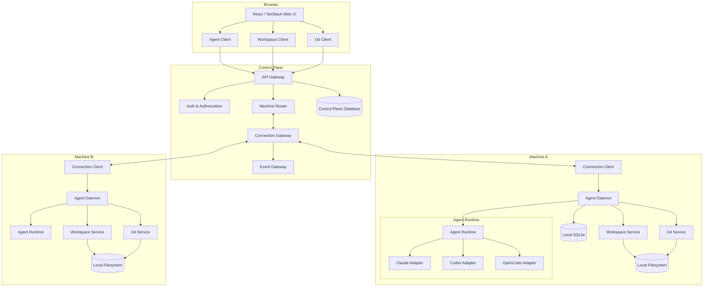
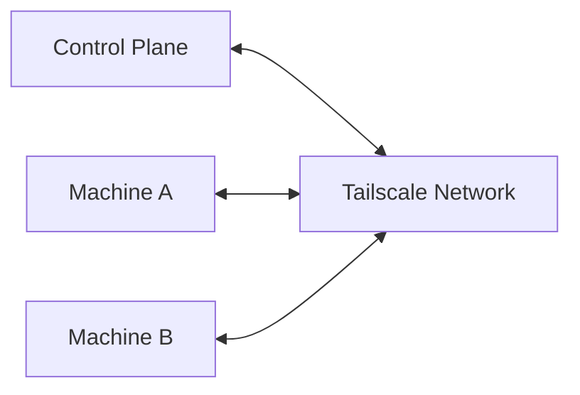
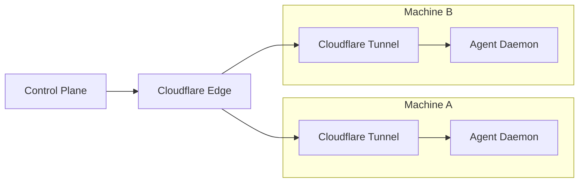
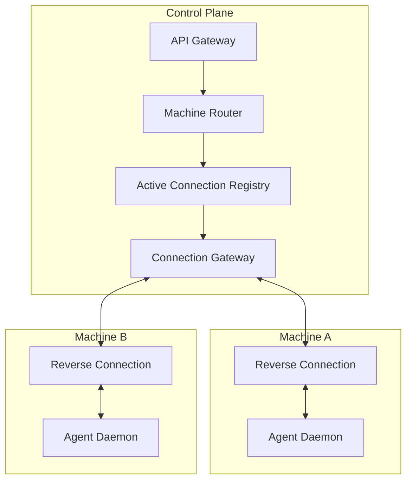
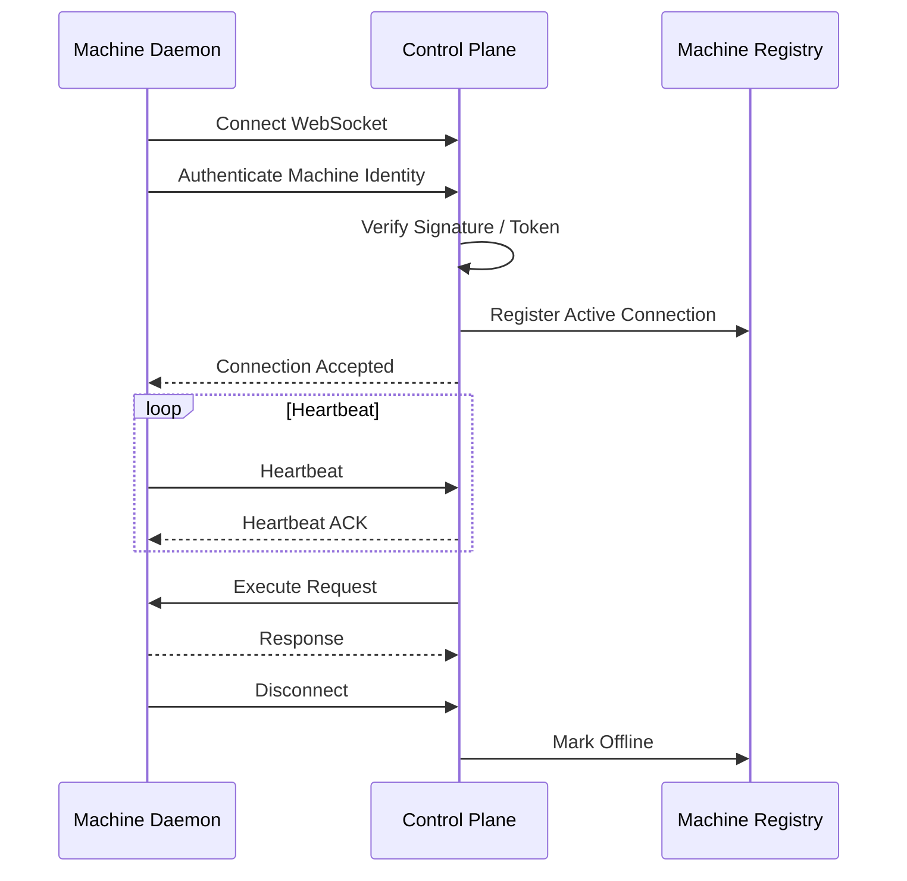
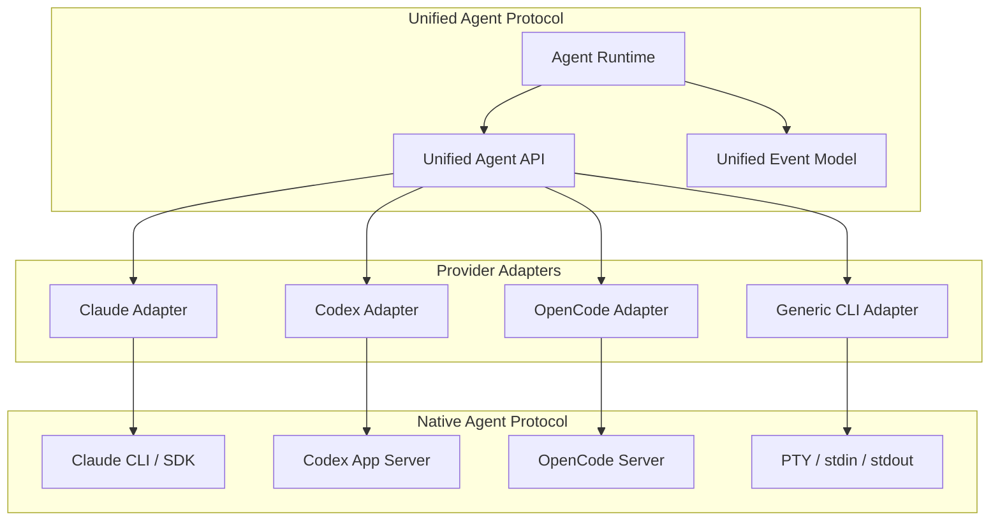
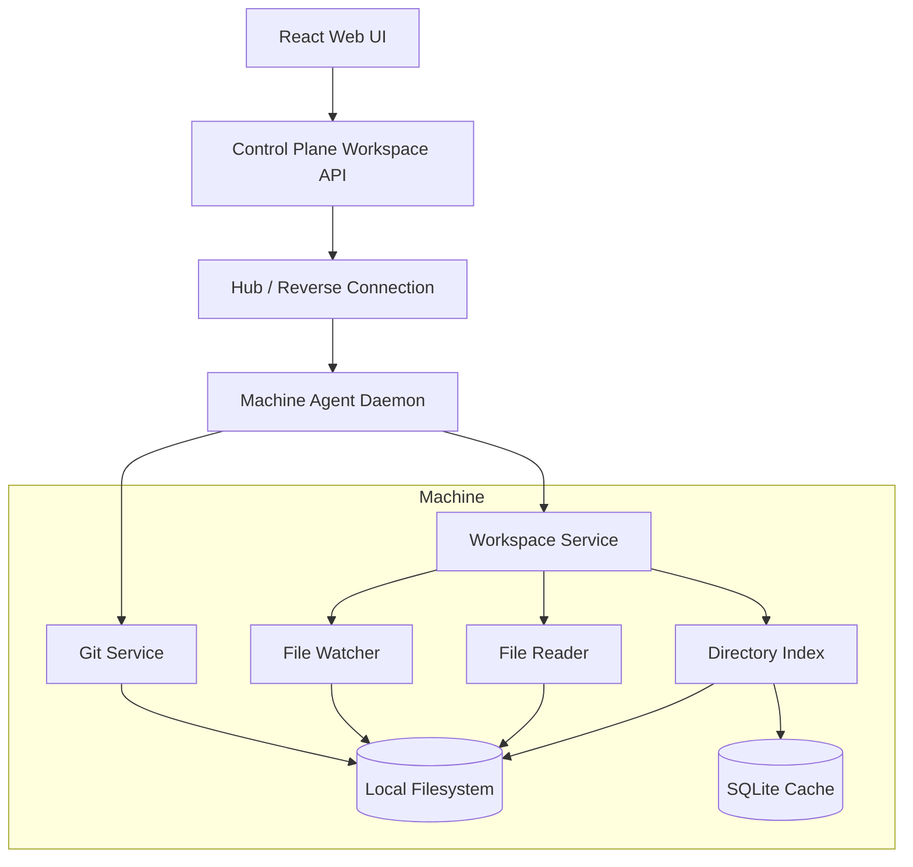
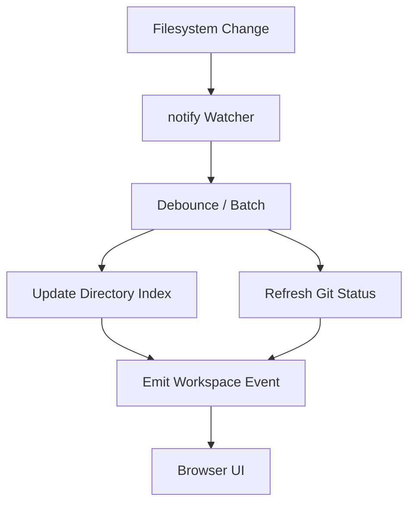
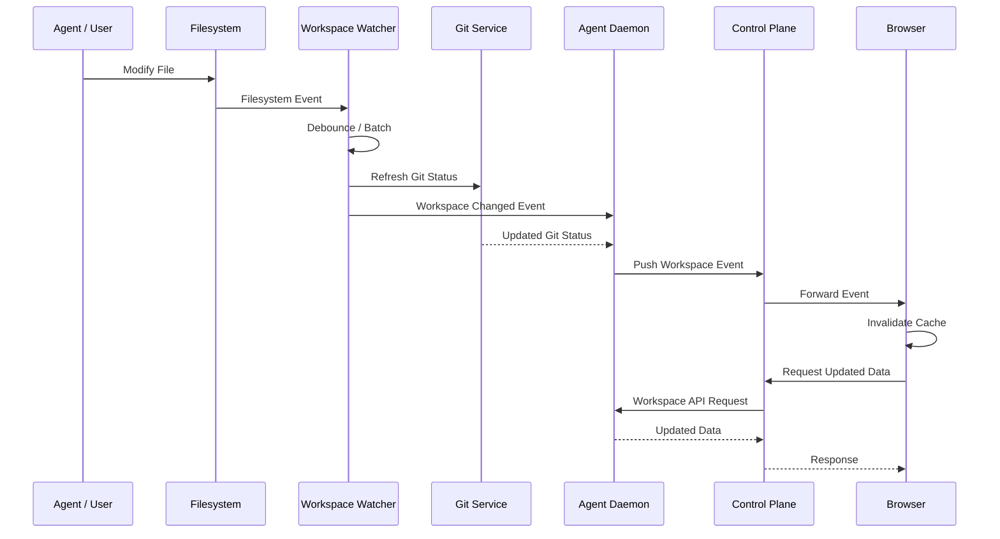

# Remote Coding Agent Management Platform
## 完整技术架构设计文档

**版本：** 1.0  
**日期：** 2026-11-13  
**状态：** Architecture Proposal

---

# 1. 项目概述

## 1.1 项目目标

构建一个远程 Coding Agent 管理平台，用于统一管理分布在多台机器上的 Coding Agent，例如：

- Claude Code
- OpenAI Codex
- OpenCode
- 其他支持命令行或标准交互协议的 Coding Agent

用户通过统一的 Web UI，可以：

1. 管理多台运行 Coding Agent 的机器。
2. 查看每台机器上可用的 Workspace。
3. 创建、启动、停止 Coding Agent Session。
4. 向正在运行的 Agent 发送消息。
5. 实时查看 Agent 的思考状态、执行事件、工具调用和输出。
6. 对需要人工确认的操作进行审批。
7. 查看 Workspace 的文件目录树和文件内容。
8. 查看 Git Status、Diff、Commit 和历史记录。
9. 在不同设备之间远程访问和管理 Coding Agent。

平台不应该要求用户将代码仓库上传到云端，也不应该要求用户将 Coding Agent 迁移到云端运行。

核心原则是：

**Coding Agent 和 Workspace 始终运行在用户自己的 Machine 上，Control Plane 负责连接、协调、授权和提供统一的 Web UI。**

## 1.2 设计原则

| 原则 | 说明 |
|---|---|
| Local-first | Agent 和代码仓库保留在用户自己的机器上 |
| Remote Control | 用户可以通过 Web UI 远程控制 Agent |
| Provider Agnostic | 支持 Claude Code、Codex、OpenCode 等不同 Agent |
| Unified Protocol | 对前端提供统一的 Agent 和 Workspace API |
| Native Integration | 尽可能使用 Coding Agent 原生协议，而不是模拟终端输入 |
| Independent Workspace | Workspace 管理能力独立于 Agent Runtime |
| No Cloud Workspace Copy | 不要求将完整代码仓库同步到 Control Plane |
| Secure by Default | Machine 身份认证、Workspace Root 限制、请求授权 |
| Event Driven | Agent 事件、文件变化和 Git 状态通过事件推送 |
| Extensible | 允许未来增加新的 Agent Provider、连接方式和工具 |

---

# 2. 总体架构

## 2.1 架构分层

系统分为三个主要部分：

1. Web UI：用户交互和可视化。
2. Control Plane：远程控制、连接管理、API、认证和事件路由。
3. Machine Agent Daemon：运行在用户机器上的本地服务，管理 Agent 和 Workspace。

Machine Agent Daemon 内部再拆分为：

- Connection Client
- Agent Runtime
- Provider Adapters
- Workspace Service
- Git Service
- Local Storage

## 2.2 整体架构图



## 2.3 组件职责

### Web UI

使用 React + TanStack 技术栈。

负责：

- Machine 管理
- Workspace 管理
- Agent Session 管理
- Agent 对话界面
- 实时事件展示
- 文件浏览器
- Git Diff Viewer
- Permission Approval
- Session 历史记录

前端不直接连接 Claude Code、Codex 或 OpenCode，也不理解它们各自的原生协议。

前端只依赖平台定义的 Unified Agent Protocol 和 Workspace Protocol。

### Control Plane

负责：

- 用户身份认证
- Machine 身份管理
- Machine Connection 管理
- Agent API
- Workspace API
- Git API
- 事件路由
- 权限校验
- 请求转发
- 连接状态管理
- 持久化 Machine 和 Session 元数据

Control Plane 不直接运行 Coding Agent，也不需要持有用户的代码仓库。

### Machine Agent Daemon

运行在用户自己的电脑或服务器上。

负责：

- 与 Control Plane 建立连接
- Machine 身份认证
- Agent 进程生命周期管理
- Provider Adapter 管理
- Agent 原生协议解析
- Agent 事件转换
- Workspace 文件访问
- Git 状态和 Diff 查询
- 文件变化监听
- 本地数据缓存
- 本地安全策略执行

建议使用 Rust 实现 Daemon。

---

# 3. Machine 与 Control Plane 的连接架构

这是整个平台最关键的基础设施之一。

由于 Machine 通常处于 NAT、家庭路由器、公司网络或动态 IP 环境中，Control Plane 不应该假设自己能够直接访问 Machine。

需要解决：

- NAT 穿透
- 动态 IP
- 防火墙
- Machine 离线和重连
- 多 Machine 管理
- 双向数据传输
- 大文件传输
- 多实例 Control Plane 下的连接路由

## 3.1 连接方案一：Tailscale

### 架构

让 Control Plane 和所有 Machine 加入同一个 Tailscale Tailnet。



Machine Agent Daemon 可以监听：

```text
127.0.0.1:18080
```

再通过 Tailscale Serve 或受限的 Tailnet 网络访问。

Control Plane 通过 MagicDNS 或 Tailscale IP 访问 Machine。

### 优点

- 自动处理 NAT 穿透。
- 尽可能建立 Direct Peer Connection。
- 无法直连时使用 DERP Relay。
- 延迟较低。
- 支持 HTTP、WebSocket 等常见协议。
- 不需要自行实现完整的反向连接传输层。

### 缺点

- Control Plane 需要加入用户的 Tailnet，或者需要通过其他方式建立跨 Tailnet 访问。
- SaaS 多租户隔离会变复杂。
- 用户需要理解 Tailnet、ACL 和设备授权。
- 将平台的核心连接能力绑定到第三方网络基础设施。

适合：

- 自托管部署。
- 企业内网。
- 用户愿意将设备加入统一 Tailnet 的场景。

## 3.2 连接方案二：Cloudflare Tunnel

每台 Machine 主动建立 Cloudflare Tunnel。

例如：

```text
machine-a.agent.example.com
machine-b.agent.example.com
```

Machine Agent Daemon 通过本地 Tunnel 将服务暴露给 Control Plane。



### 优点

- Machine 只需要出站连接。
- 不需要公网 IP。
- 不需要开放公网入站端口。
- 可以使用 Cloudflare Access 和 Service Token。
- 对 SaaS 部署比较友好。

### 缺点

- 每台 Machine 需要配置 Tunnel。
- 每台机器需要维护域名或服务路由。
- 需要处理 Cloudflare Access 身份与平台用户授权之间的关系。
- 对大量用户机器而言，Tunnel 生命周期和配置管理会增加复杂度。

注意：

Cloudflare Service Token 只能证明服务身份，不能代替平台自身的用户身份认证和资源授权。

## 3.3 连接方案三：Reverse Connection（推荐）

推荐将 Machine Agent Daemon 主动连接 Control Plane，建立持久的双向连接。

这是一种标准的反向连接架构。

Machine 不需要等待 Control Plane 主动连接自己，而是主动连接 Control Plane。



### 工作流程

1. Machine Agent Daemon 启动。
2. Daemon 使用 Machine Identity 向 Control Plane 认证。
3. Control Plane 验证 Machine 身份。
4. 双方建立持久 WebSocket 连接。
5. Control Plane 记录 Machine ID 对应的活跃连接。
6. 浏览器发起请求。
7. Control Plane 根据 Machine ID 找到连接。
8. Control Plane 通过现有连接向 Machine 发送请求。
9. Machine 执行任务并返回结果。
10. Control Plane 将结果返回浏览器。

### 核心优势

- Machine 不需要公网 IP。
- 不需要 Control Plane 加入用户的 Tailnet。
- 不需要每台 Machine 配置独立域名。
- 不需要用户配置路由器。
- 可以支持大量分散在不同网络中的 Machine。
- 连接建立和身份认证由平台统一管理。

**建议将 Reverse Connection 作为默认连接方式。**

Tailscale 和 Cloudflare Tunnel 可以作为可选的 Direct Connection Provider。

## 3.4 三种方案的定位

| 方案 | 推荐用途 | 定位 |
|---|---|---|
| Reverse Connection | SaaS、多用户、多机器 | 默认方案 |
| Tailscale | 自托管、企业内网 | 可选直连 |
| Cloudflare Tunnel | 已使用 Cloudflare 的用户 | 可选直连 |

平台内部抽象统一的 Machine Connection 接口：

```rust
#[async_trait]
pub trait MachineConnection: Send + Sync {
    async fn connect(&self) -> Result<()>;

    async fn disconnect(&self) -> Result<()>;

    async fn send(
        &self,
        message: MachineMessage,
    ) -> Result<()>;

    async fn next_message(
        &mut self,
    ) -> Result<Option<MachineMessage>>;
}
```

未来可以增加：

- WebSocket Reverse Connection
- Tailscale Connection
- Cloudflare Tunnel Connection
- QUIC Connection

而不需要修改 Agent Runtime 或 Workspace Service。

---

# 4. Reverse Connection 协议设计

## 4.1 传输协议

第一阶段建议使用：

**WebSocket + JSON Control Frame + Binary Data Frame**

原因：

- 实现成本低。
- 浏览器和 Rust 都有成熟支持。
- 支持双向通信。
- 可以承载 Agent 事件和控制请求。
- 可以支持逻辑多路复用。
- 后续可以扩展为 HTTP Streaming 或 QUIC。

不要一开始就实现复杂的自定义网络传输协议。

## 4.2 连接生命周期



连接认证有两种模式：首次配对时 upgrade 不带凭据，`connection.hello` 携带
一次性 `pairing_code`，Admin 校验通过后在 `connection.accepted` 返回
`machine_token` 和 `org_id`；之后每次连接都在 upgrade 带
`Authorization: Bearer <machine-token>` 并对 challenge 签名。配对码在事务中
被消费，不能重放；已 pin 的机器缺少 token 时返回 `machine_token_required`。

建议支持：

- Connection ID
- Machine ID
- Heartbeat
- Last Seen
- Connection State
- Reconnect
- Exponential Backoff
- Request Timeout
- Connection Version
- Protocol Version Negotiation

## 4.3 多路复用

一个 Machine 只维护一个主要连接，但连接内部需要支持多个逻辑 Stream。

例如：

- Agent Events
- Agent Commands
- Workspace Tree
- Workspace File Content
- Git Status
- Git Diff
- Health
- File Change Events

消息结构：

```json
{
  "version": 1,
  "stream_id": "stream_123",
  "message_id": "msg_456",
  "type": "request",
  "method": "workspace.tree.list",
  "payload": {
    "workspace_id": "ws_123",
    "path": "src"
  }
}
```

响应：

```json
{
  "version": 1,
  "stream_id": "stream_123",
  "message_id": "msg_456",
  "type": "response",
  "payload": {
    "entries": []
  }
}
```

事件：

```json
{
  "version": 1,
  "stream_id": "agent_events",
  "type": "event",
  "event": "agent.message.delta",
  "payload": {}
}
```

### 必须支持的能力

| 能力 | 作用 |
|---|---|
| Request / Response | 请求与响应关联 |
| Stream ID | 区分不同逻辑流 |
| Message ID | 消息去重与关联 |
| Chunked Transfer | 大文件和大型 Diff 分块传输 |
| Backpressure | 防止发送速度超过接收能力 |
| Timeout | 防止请求永久等待 |
| Stream Cancel | 取消正在执行的请求 |
| Reconnect | 断线后恢复连接 |
| Protocol Version | 兼容不同 Daemon 版本 |

## 4.4 消息类型

建议至少支持：

```text
connection.hello
connection.auth
connection.accepted
connection.heartbeat
connection.heartbeat_ack
connection.disconnect

request
response
error
event

stream.open
stream.chunk
stream.end
stream.cancel
```

## 4.5 多实例 Control Plane

如果 Control Plane 未来采用多实例部署，不能只依赖某一个实例的内存保存连接信息。

需要区分：

- Machine Connection：实际 WebSocket 连接，属于临时状态。
- Machine Registry：Machine 元数据和连接状态。
- Connection Routing：将请求路由到持有实际连接的实例。

可以采用：

```text
Control Plane API
       |
       v
Machine Router
       |
       v
Connection Registry
       |
       +---- Redis / NATS
       |
       v
Connection Gateway Instance
       |
       v
Machine Connection
```

Redis 可以保存：

```text
machine_id
connection_id
gateway_instance_id
connected_at
last_seen_at
```

NATS 或其他消息系统可以用于跨实例转发请求和事件。

第一阶段单实例可以直接使用内存 Connection Registry，并在架构上保留接口。

---

# 5. Agent Runtime 架构

## 5.1 设计目标

Agent Runtime 负责统一管理不同 Coding Agent 的生命周期和交互。

需要支持：

- 创建 Agent Session
- 启动 Agent
- 发送用户消息
- 获取 Agent 输出
- 实时接收事件
- 中断 Agent
- 恢复 Session
- 处理权限请求
- 关闭 Agent
- 记录 Session 状态

最重要的设计原则：

**Agent Runtime 使用统一内部协议，但每个 Provider Adapter 应尽可能使用对应 Coding Agent 的原生协议。**

## 5.2 两层协议架构



这样做的原因：

- Provider 原生协议变化不会影响 Web UI。
- 可以统一 Session、Turn、Message、Tool Call 等概念。
- 不同 Agent 的特殊能力可以通过 Extension 保留。
- 可以逐步增加新的 Provider。

## 5.3 Agent Runtime Trait

Rust 可以定义统一接口：

```rust
#[async_trait]
pub trait AgentProvider: Send + Sync {
    async fn start(
        &self,
        config: AgentStartConfig,
    ) -> Result<AgentSession>;

    async fn send_message(
        &self,
        session_id: &str,
        message: AgentMessage,
    ) -> Result<()>;

    async fn interrupt(
        &self,
        session_id: &str,
    ) -> Result<()>;

    async fn resume(
        &self,
        session_id: &str,
    ) -> Result<()>;

    async fn shutdown(
        &self,
        session_id: &str,
    ) -> Result<()>;

    async fn next_event(
        &self,
        session_id: &str,
    ) -> Result<Option<AgentEvent>>;
}
```

实际实现可以根据 Provider 能力定义 Capability：

```rust
pub struct AgentCapabilities {
    pub streaming: bool,
    pub interrupt: bool,
    pub resume: bool,
    pub permission_approval: bool,
    pub structured_events: bool,
    pub structured_diff: bool,
    pub session_persistence: bool,
}
```

注意：并不是所有 Provider 都具备全部能力。

Adapter 应声明自己真正支持的能力，而不是强行模拟。

## 5.4 Claude Code Adapter

Claude Code 有两条主要集成路径。

### 路径 A：Claude Agent SDK

官方文档：

https://platform.claude.com/docs/en/agent-sdk/overview

SDK 提供更高级的 Agent 集成能力。

可以考虑：

```text
Rust Agent Daemon
       |
       | JSON-RPC / stdio
       |
TypeScript Worker
       |
       |
Claude Agent SDK
       |
       |
Claude Code Runtime
```

优势：

- SDK 提供结构化交互。
- 更容易使用 Session、Tool、Permission 等高级能力。
- 可以减少直接解析底层 CLI 协议的工作。

缺点：

- 需要额外维护 Node.js Worker。
- Rust 和 TypeScript 之间需要一层通信协议。
- SDK 的版本升级需要同步维护。

不建议因此将整个 Agent Daemon 改成 Node.js 服务。

### 路径 B：Claude CLI Streaming JSON

可以评估 Claude Code CLI 的 Streaming JSON 模式。

示意：

```bash
claude \
  -p \
  --input-format stream-json \
  --output-format stream-json \
  --verbose
```

通过 stdin/stdout JSONL 进行消息交换。

典型流程：

```text
Rust Agent Daemon
       |
       | stdin/stdout JSONL
       |
Claude Code CLI
```

优点：

- 不需要单独维护 SDK Worker。
- 与现有 Claude Code CLI 安装方式一致。
- Rust 可以直接管理子进程。
- JSONL 容易调试。

需要特别注意：

CLI 不同运行模式的交互能力可能存在差异。

在正式实现前，需要针对目标 Claude Code 版本验证：

- 是否支持持续输入。
- 是否支持 Session Resume。
- 是否支持 Interrupt / Steering。
- 是否支持权限请求与审批。
- 是否支持完整的结构化事件。
- 是否能够在运行期间继续接收用户消息。

不能仅凭 Streaming JSON 的存在，就假设它具备完整的双向 Agent Control 能力。

### 推荐

先实现 CLI Adapter 进行可行性验证。

如果发现 SDK 在 Session 控制、权限审批和事件流方面具有明显优势，再引入独立 TypeScript Worker。

## 5.5 Codex Adapter

推荐使用：

**Codex App Server**

文档：

https://developers.openai.com/codex/app-server/

Codex App Server 提供结构化的 Agent 控制协议。

主要特点：

- JSON-RPC 2.0
- stdio JSONL
- Request / Response
- Server Notifications
- Thread 管理
- Turn 管理
- Item 事件
- Agent Message Streaming
- 工具调用和审批相关事件

架构：

```text
Rust Agent Daemon
       |
       | JSON-RPC 2.0 / JSONL
       |
codex app-server
```

Codex App Server 是比简单 PTY 模拟更合适的集成方式。

建议根据当前安装版本生成 TypeScript 或 JSON Schema：

```bash
codex app-server generate-ts --out ./schemas
```

也可以生成 JSON Schema，用于 Rust 侧生成或校验类型。

协议中的具体方法和事件应以当前版本 Schema 为准。

## 5.6 OpenCode Adapter

OpenCode 可以通过其 Server API 集成。

推荐架构：

```text
Rust Agent Daemon
       |
       | HTTP / SSE / WebSocket（按目标版本能力选择）
       |
OpenCode Server
```

Adapter 负责：

- 创建和管理 Session。
- 发送用户消息。
- 订阅事件。
- 获取消息历史。
- 处理中断。
- 转换 Provider 事件。

需要根据实际 OpenCode 版本确认 API 和事件订阅机制，不应将 OpenCode 内部协议直接暴露给前端。

## 5.7 Generic CLI Adapter

对于不支持结构化协议的 Agent，可以提供通用兼容层。

使用：

- PTY
- stdin
- stdout
- stderr
- Process Management

但应明确它只是兼容方案。

与原生协议相比，PTY 模式存在：

- 需要解析终端文本。
- 难以准确识别工具调用。
- 难以结构化识别权限请求。
- 中断和 Session 恢复能力不稳定。
- UI 展示能力较弱。

优先级应该低于 Provider Native Adapter。

## 5.8 MCP 的定位

MCP 不应该作为整个 Coding Agent 的控制协议。

MCP 更适合：

- Tool Calling
- Resources
- Prompts
- 外部工具扩展

但 Coding Agent UI 还需要理解：

- Session 生命周期
- Turn 生命周期
- Message Delta
- Tool Call 生命周期
- Permission Request
- Agent State
- 文件变更
- Diff
- 中断与恢复

MCP 不能完整代替这些语义。

因此：

- Agent Protocol：负责 Coding Agent 的生命周期和交互。
- MCP：负责 Agent 可调用的工具与资源扩展。

---

# 6. Unified Agent Protocol

## 6.1 核心对象

建议统一以下概念：

```text
Provider
  └── Agent
       └── Session
            ├── Turn
            │    ├── Message
            │    ├── Tool Call
            │    ├── Permission Request
            │    └── Event
            └── Session Metadata
```

### Session

表示一个持续存在的 Agent 会话。

```json
{
  "id": "session_123",
  "machine_id": "machine_123",
  "workspace_id": "workspace_123",
  "provider": "claude",
  "agent_type": "claude-code",
  "status": "running",
  "cwd": "/workspace/project",
  "created_at": "2026-11-13T10:00:00Z"
}
```

### Turn

表示 Agent 对一次用户输入的处理过程。

```json
{
  "id": "turn_123",
  "session_id": "session_123",
  "status": "running",
  "started_at": "2026-11-13T10:00:00Z"
}
```

### Message

表示消息内容。

```json
{
  "id": "message_123",
  "session_id": "session_123",
  "turn_id": "turn_123",
  "role": "assistant",
  "content": "I am analyzing the project..."
}
```

### Tool Call

```json
{
  "id": "tool_123",
  "session_id": "session_123",
  "name": "Read",
  "status": "completed",
  "input": {},
  "output": {}
}
```

### Permission Request

```json
{
  "id": "permission_123",
  "session_id": "session_123",
  "tool_name": "Bash",
  "description": "Execute shell command",
  "status": "pending"
}
```

## 6.2 Unified Event Model

建议统一事件类型：

```text
session.created
session.started
session.resumed
session.terminated
session.error

turn.started
turn.completed
turn.interrupted
turn.failed

message.started
message.delta
message.completed

tool.started
tool.input.delta
tool.completed
tool.failed

permission.requested
permission.approved
permission.rejected

agent.status.changed
agent.raw_event
```

事件示例：

```json
{
  "event_id": "evt_123",
  "session_id": "session_123",
  "turn_id": "turn_123",
  "sequence": 1024,
  "type": "message.delta",
  "timestamp": "2026-11-13T10:00:00Z",
  "payload": {
    "text": "Hello"
  }
}
```

建议保留：

- `sequence`：事件顺序。
- `event_id`：事件去重。
- `timestamp`：事件时间。
- `provider`：事件来源。
- `raw_event`：必要时保留 Provider 原始数据。

前端只消费统一事件，调试界面可以查看原始事件。

---

# 7. Workspace Service 架构

## 7.1 为什么需要独立 Workspace Service

Workspace 和 Agent Runtime 是两种不同的职责。

Agent Runtime 负责：

- Agent 对话
- Tool Call
- Session 生命周期
- Agent 事件

Workspace Service 负责：

- 文件系统访问
- 目录树
- 文件内容
- 文件搜索
- 文件变化监听

Git Service 负责：

- Git Status
- Git Diff
- Branch
- Commit
- History

三者应该独立。

尤其不能让 Web UI 为了查看代码目录或 Git Diff 而向 Coding Agent 发送 Prompt。

**查看代码应该是一个本地文件系统和 Git 操作，而不是一次 Agent 对话。**

## 7.2 Workspace 架构图



## 7.3 Workspace 数据模型

建议定义：

```text
Project
  └── Workspace
       ├── Root Directory
       ├── Git Repository
       ├── File Index
       ├── File Watcher
       └── Agent Sessions
```

Project 可以对应一个项目。

一个 Project 可以有多个 Workspace。

例如：

```text
Project: FastCart

Workspace A:
  /Users/user/Projects/fastcart

Workspace B:
  /Users/user/Projects/fastcart-worktree-1

Workspace C:
  /Users/user/Projects/fastcart-worktree-2
```

多个 Session 可以共享一个 Workspace，但需要明确共享关系。

更推荐：

**每个 Session 默认使用独立 Git Worktree。**

这样多个 Agent 不容易相互覆盖代码。

## 7.4 Workspace 数据结构

```rust
pub struct Workspace {
    pub id: String,
    pub project_id: String,
    pub name: String,
    pub root_path: PathBuf,
    pub git_repository: Option<PathBuf>,
    pub created_at: DateTime<Utc>,
}
```

目录项：

```rust
pub struct WorkspaceEntry {
    pub path: String,
    pub name: String,
    pub entry_type: EntryType,
    pub size: Option<u64>,
    pub modified_at: Option<i64>,
    pub git_status: Option<GitFileStatus>,
}
```

SQLite 缓存表：

```sql
CREATE TABLE workspace_entries (
    id INTEGER PRIMARY KEY,
    workspace_id TEXT NOT NULL,
    parent_id INTEGER,
    path TEXT NOT NULL,
    name TEXT NOT NULL,
    entry_type TEXT NOT NULL,
    size INTEGER,
    mtime_ns INTEGER,
    inode INTEGER,
    git_status TEXT,
    ignored INTEGER NOT NULL DEFAULT 0,
    UNIQUE(workspace_id, path)
);

CREATE INDEX idx_workspace_parent
ON workspace_entries(workspace_id, parent_id);
```

这个数据库只是本地缓存和索引，不应该成为文件内容的权威数据源。

真正的文件内容仍以本地文件系统为准。

---

# 8. 目录树实现

## 8.1 不要一次性加载整个目录树

大型代码仓库可能有数十万文件。

不建议在打开 Workspace 时递归扫描所有目录，然后将完整目录树返回浏览器。

推荐：

- 首次只加载根目录。
- 用户展开目录时才加载子目录。
- 每个目录独立分页。
- 前端缓存已加载目录。
- 目录内容发生变化时，只刷新对应目录。

## 8.2 目录扫描

Rust 可以使用 `ignore` crate。

它支持：

- `.gitignore`
- 隐藏文件过滤
- Ignore Rules
- 并行目录遍历

可以通过统一配置决定是否显示：

- `.git`
- `node_modules`
- `target`
- `.next`
- `dist`
- 其他忽略目录

建议将默认忽略规则与 Git Ignore 规则分开处理。

用户可以选择查看被忽略的文件。

## 8.3 目录树 API

请求：

```http
GET /api/v1/workspaces/:workspace_id/tree?path=src&limit=200
```

响应：

```json
{
  "path": "src",
  "entries": [
    {
      "name": "lib.rs",
      "path": "src/lib.rs",
      "type": "file",
      "size": 2048
    },
    {
      "name": "agent",
      "path": "src/agent",
      "type": "directory"
    }
  ],
  "next_cursor": null
}
```

对于超大目录，使用 cursor 分页。

## 8.4 文件系统变化监听

推荐使用 Rust `notify` crate。

工作流程：



注意：

文件系统 Watcher 事件不一定完整。

可能发生：

- 重复事件
- 合并事件
- 丢失事件
- 大量事件爆发
- 文件移动导致的复杂事件

因此不能将 Watcher 作为唯一事实来源。

推荐策略：

1. Watcher 用于低延迟变化通知。
2. 收到事件后更新受影响的缓存。
3. 对无法确认的变化执行局部重新扫描。
4. 定期执行目录校准。
5. 必要时使用 mtime、size、inode 和 content hash 判断变化。

---

# 9. 文件内容读取

## 9.1 按需加载

浏览器不需要预加载整个 Workspace 的文件内容。

只有用户打开文件时才获取内容。

API：

```http
GET /api/v1/workspaces/:workspace_id/files?path=src/lib.rs
```

响应：

```json
{
  "path": "src/lib.rs",
  "content": "pub fn main() {}",
  "encoding": "utf-8",
  "size": 1024,
  "etag": "abc123"
}
```

## 9.2 ETag 与缓存

推荐使用：

```http
If-None-Match: "abc123"
```

如果文件没有变化：

```http
304 Not Modified
```

这样可以减少远程传输。

## 9.3 大文件处理

需要支持：

- 文件大小限制
- 二进制文件检测
- UTF-8 编码检查
- 大文件分块读取
- 读取取消
- 请求超时

对于图片、PDF 等非文本文件，可以在后续扩展独立预览能力。

## 9.4 文件安全

必须防止：

### 路径穿越

例如：

```text
../../.ssh/id_rsa
```

### 符号链接逃逸

例如 Workspace 内存在指向 Workspace Root 外部的符号链接。

### 任意路径访问

浏览器不能直接传入任意系统绝对路径。

所有访问都必须经过 Workspace Root 限制。

建议：

- 将 Workspace ID 映射到本地注册的 Root。
- 对用户输入的相对路径执行规范化。
- 拒绝 `..` 路径逃逸。
- 检查符号链接最终目标。
- 尽可能使用安全的目录句柄相对访问方式。
- 限制文件大小。
- 对每次文件访问执行权限检查。

不要只依赖字符串前缀判断路径是否位于 Workspace 内。

---

# 10. Git Service 架构

## 10.1 为什么需要独立 Git Service

Git 是代码状态的权威数据源之一。

不能依赖 Agent 输出的 Diff 来判断代码变化。

原因：

- 用户可能通过 IDE 修改文件。
- 多个 Agent 可能修改同一个仓库。
- Agent 可能没有正确报告所有修改。
- Agent 可能异常退出。
- 文件可能在 Agent 运行期间被外部程序修改。

因此：

**Git Service 必须直接观察本地 Git Repository。**

## 10.2 Git Service 职责

负责：

- Repository Discovery
- Branch
- Status
- Diff
- Commit
- Log
- History
- Changed Files
- File-level Diff

## 10.3 推荐 Git 实现方式

第一阶段推荐直接使用 Git CLI。

例如：

```bash
git status --porcelain=v2 -z --branch
git diff
git diff --cached
git diff BASE..HEAD
git diff -- src/lib.rs
```

优势：

- 行为与本机 Git 保持一致。
- 不需要自己实现 Git 兼容逻辑。
- 对 Submodule、特殊 Git 状态等场景更容易跟随 Git 官方行为。
- Rust 只需要负责进程管理和输出解析。

`git status --porcelain=v2` 是适合脚本解析的稳定机器格式。

需要正确处理 NUL 分隔符，不能简单按换行符拆分。

未来如果性能或部署需求明显，再评估 libgit2。

## 10.4 Git Status API

请求：

```http
GET /api/v1/workspaces/:workspace_id/git/status
```

响应：

```json
{
  "branch": "feature/daemon-runtime",
  "ahead": 1,
  "behind": 0,
  "files": [
    {
      "path": "src/lib.rs",
      "status": "modified",
      "staged": false
    },
    {
      "path": "src/new.rs",
      "status": "untracked",
      "staged": false
    }
  ]
}
```

## 10.5 Git Diff API

请求：

```http
GET /api/v1/workspaces/:workspace_id/git/diff?path=src/lib.rs
```

统一 Diff Model：

```json
{
  "path": "src/lib.rs",
  "status": "modified",
  "additions": 10,
  "deletions": 3,
  "hunks": [
    {
      "old_start": 10,
      "old_lines": 5,
      "new_start": 10,
      "new_lines": 12,
      "lines": [
        {
          "type": "context",
          "content": "..."
        },
        {
          "type": "added",
          "content": "..."
        },
        {
          "type": "deleted",
          "content": "..."
        }
      ]
    }
  ]
}
```

## 10.6 Untracked Files

需要特别处理：

`git diff` 默认不会展示未跟踪文件的内容。

因此 Git Service 需要结合 Status 和文件系统信息处理：

- Modified
- Added
- Deleted
- Renamed
- Copied
- Untracked

对于 Untracked 文件，需要从文件系统读取内容，并将其转换成统一的新增 Diff 表示。

还要处理：

- 二进制文件
- 大型文件
- Git LFS
- Submodule
- 文件重命名
- 暂存区与工作区的区别

## 10.7 Diff 性能优化

不要在页面打开时一次性返回所有文件的完整 Diff。

建议分成两级：

### Diff Summary

返回：

- 文件路径
- 修改类型
- 新增行数
- 删除行数
- 是否二进制
- 是否已暂存

### File Diff

用户展开文件时，再请求完整 Diff。

这样可以避免大量代码内容被无意义地传输。

---

# 11. Workspace 实时同步

## 11.1 实时同步流程



## 11.2 事件类型

```text
workspace.directory.changed
workspace.file.created
workspace.file.modified
workspace.file.deleted
workspace.file.renamed

git.status.changed
git.branch.changed
git.diff.changed
```

事件示例：

```json
{
  "event_id": "evt_123",
  "workspace_id": "ws_123",
  "type": "workspace.file.modified",
  "payload": {
    "path": "src/lib.rs"
  }
}
```

## 11.3 前端更新策略

使用 TanStack Query 管理数据缓存。

收到事件后：

- 更新对应目录缓存。
- 更新对应文件状态。
- 使 Git Status 缓存失效。
- 如果当前正在查看对应文件，则提示内容已变化。
- 如果当前正在查看对应文件的 Diff，则刷新 Diff。

需要特别注意：

如果用户正在 Monaco Editor 中编辑尚未保存的内容，不能因为收到远程文件变化事件就静默覆盖用户输入。

应该保留本地编辑缓冲，并提示用户文件已经在磁盘上发生变化。

---

# 12. Web UI 架构

## 12.1 技术栈建议

| 层次 | 技术 |
|---|---|
| UI | React |
| Routing | TanStack Router |
| Data Fetching | TanStack Query |
| Editor | Monaco Editor |
| Diff | Monaco Diff Editor |
| State | Zustand 或 TanStack Query |
| Styling | Tailwind CSS |
| Transport | HTTP + WebSocket |
| Type Safety | OpenAPI / TypeScript Schema |

## 12.2 UI 模块

```text
src/
├── app/
│   ├── router.tsx
│   └── providers.tsx
│
├── features/
│   ├── machines/
│   ├── projects/
│   ├── workspaces/
│   ├── agents/
│   ├── sessions/
│   ├── permissions/
│   ├── files/
│   └── git/
│
├── components/
│   ├── layout/
│   ├── editor/
│   ├── terminal/
│   ├── diff/
│   └── status/
│
├── lib/
│   ├── api/
│   ├── events/
│   └── query/
│
└── types/
```

## 12.3 Agent Session 页面

建议采用类似 Coding Agent IDE 的布局：

```text
+------------------------------------------------------+
| Machine / Project / Workspace / Session             |
+------------------+-----------------------------------+
|                  |                                   |
| Workspace        | Agent Conversation                |
|                  |                                   |
| - src            | User Message                      |
| - tests          |                                   |
| - Cargo.toml     | Agent Response                    |
|                  |                                   |
| Git Changes      | Tool Calls                        |
| - Modified       |                                   |
| - Untracked      | Permission Requests               |
|                  |                                   |
+------------------+-----------------------------------+
| Input Composer                                       |
+------------------------------------------------------+
```

可以进一步支持：

- 文件树与 Agent 对话并排。
- Git Diff 独立面板。
- Tool Call 折叠展示。
- Permission Approval。
- 多 Session Tab。
- 多 Machine 切换。
- Workspace 状态栏。

## 12.4 文件浏览器

目录树采用懒加载。

点击文件时：

1. 请求文件内容。
2. 检查文件类型。
3. 选择对应 Editor。
4. 使用 ETag 缓存。
5. 监听文件变化事件。

## 12.5 Git Diff Viewer

使用 Monaco Diff Editor。

基本流程：

```text
Browser
   |
   | Request Diff Summary
   v
Control Plane
   |
   v
Machine Agent Daemon
   |
   v
Git Service
   |
   v
Git CLI
   |
   v
Unified Diff Model
   |
   v
Monaco Diff Editor
```

---

# 13. Control Plane API 设计

建议统一 REST API 和 WebSocket Event。

## 13.1 Machine API

```http
GET    /api/v1/machines
GET    /api/v1/machines/:id
POST   /api/v1/machines/:id/reconnect
DELETE /api/v1/machines/:id                 # 永久吊销
GET    /api/v1/machines/revoked
POST   /api/v1/machines/:id/unrevoke
POST   /api/v1/pairing/codes                # 创建一次性配对码
```

## 13.2 Project API

```http
GET    /api/v1/projects
POST   /api/v1/projects
GET    /api/v1/projects/:id
PATCH  /api/v1/projects/:id
DELETE /api/v1/projects/:id
```

## 13.3 Workspace API

```http
GET    /api/v1/workspaces
POST   /api/v1/workspaces
GET    /api/v1/workspaces/:id
DELETE /api/v1/workspaces/:id

GET    /api/v1/workspaces/:id/tree
GET    /api/v1/workspaces/:id/files
GET    /api/v1/workspaces/:id/search
```

## 13.4 Git API

```http
GET    /api/v1/workspaces/:id/git/status
GET    /api/v1/workspaces/:id/git/diff
GET    /api/v1/workspaces/:id/git/branches
GET    /api/v1/workspaces/:id/git/log
```

后续可以增加：

```http
POST   /api/v1/workspaces/:id/git/stage
POST   /api/v1/workspaces/:id/git/unstage
POST   /api/v1/workspaces/:id/git/commit
POST   /api/v1/workspaces/:id/git/checkout
```

这些写操作应有独立授权策略和审计记录。

## 13.5 Agent API

```http
GET    /api/v1/agents
GET    /api/v1/sessions
POST   /api/v1/sessions
GET    /api/v1/sessions/:id
POST   /api/v1/sessions/:id/messages
POST   /api/v1/sessions/:id/interrupt
POST   /api/v1/sessions/:id/resume
DELETE /api/v1/sessions/:id
```

## 13.6 Permission API

```http
GET    /api/v1/sessions/:id/permissions
POST   /api/v1/permissions/:id/approve
POST   /api/v1/permissions/:id/reject
```

## 13.7 Event API

```text
WS /api/v1/events
```

前端通过一个统一事件连接接收：

- Machine 状态
- Agent Session 事件
- Agent Message Delta
- Tool Call
- Permission Request
- Workspace 变化
- Git Status 变化

Control Plane 负责按照用户权限过滤事件。

---

# 14. 数据存储设计

建议 Control Plane 和 Machine 分别维护自己的数据库。

## 14.1 Control Plane 数据库

保存平台管理数据，不保存完整代码仓库。

建议表：

```text
users
organizations
machines
machine_connections
machine_revocations
pairing_codes
projects
workspaces
agent_providers
agent_sessions
agent_turns
agent_messages
agent_events
permission_requests
audit_logs
```

Machine Connection 的活跃连接信息属于临时状态。

可以将连接状态写入数据库，但真正的 Socket 对象不应该持久化。

## 14.2 Machine 本地数据库

建议使用 SQLite。

主要保存：

```text
machine_config
workspace_registry
workspace_entries
agent_sessions
agent_processes
agent_events
provider_config
local_settings
```

本地数据库可以承担：

- Workspace 元数据
- 目录树缓存
- Session 元数据
- 本地事件索引
- Agent 进程状态
- 断线恢复信息

不要将 SQLite 中的缓存当成文件系统或 Git 的最终事实来源。

## 14.3 事件存储策略

Agent Event 可能非常多。

建议区分：

- 实时事件：通过 WebSocket 转发。
- Session Message：适当持久化。
- Tool Call：保存结构化记录。
- Debug Raw Event：可配置保留。
- 高频 Delta：可以批量写入或聚合。

不要无条件将所有高频事件永久保存。

---

# 15. 安全架构

安全是整个系统的重要组成部分。

尤其是 Machine Daemon 可以访问用户本地代码、文件和执行环境。

## 15.1 Machine Identity

每台 Machine 有独立身份和独立凭据。

Machine 使用 Ed25519 密钥对：

```text
Machine Private Key   (~/.fleet/daemon/machine.key, 0600)
Machine Public Key
Machine ID            (<key_file>.id，跨密钥轮换保持不变)
```

**首次注册（配对）流程（同机/同内网已实现）：**

1. 管理员通过 `POST /api/v1/pairing/codes`（或
   `fleet admin machines pair-code` / `fleet daemon setup`）创建一次性配对码。
   配对码绑定组织、创建者和可选的机器名提示，
   默认 TTL 600 秒（`auth.pair_code_ttl_secs`），最多 5 次失败
   （`auth.pair_code_max_attempts`），数据库只保存 SHA-256 哈希。
2. Daemon 生成密钥对（若不存在），在 `connection.hello` 中携带
   `pairing_code`，并对 Admin 的 challenge 签名。
3. Control Plane 校验配对码和签名后，在一个事务内消费配对码、保存 Public Key、
   记录 machine/org，并在 `connection.accepted` 返回 `machine_token`
   （`flm_<64 hex>`，仅存哈希）和 `org_id`。
4. Daemon 将 token 写入 `<key_file>.token`（0600）。后续连接使用
   `Authorization: Bearer <machine-token>` + challenge 签名，不再使用配对码。

Private Key 和 per-machine token 都只保留在 Machine 本地；daemon TOML 不保存
token。不存在共享 token、TOFU 或仅密钥认证路径。未配对机器返回
`machine_not_paired`，已 pin 但无 token 返回 `machine_token_required`，配对码
无效/过期/已用/超次数统一返回 `pairing_code_invalid`。

**密钥轮换**：新密钥必须附带旧密钥对 rotation statement 的签名
（`KeyRotationProof`）；否则返回 `machine_key_mismatch`。**吊销**：
`DELETE /api/v1/machines/:id` 写入永久吊销记录，机器在 unrevoke 之前不能重新
配对。

**已知限制与后续工作**：当前仅支持同机/同内网显式配对；远程/离线/延迟注册、
QR 码、OAuth device flow、UI 配对、按 IP 限流（当前为进程内限流，NAT 后共享
额度）以及跨重启的尝试计数仍未实现。

## 15.2 用户授权

Machine 身份认证和用户授权必须分开。

Machine 证明：

“我是哪一台机器？”

用户授权证明：

“当前用户是否有权访问这台机器的 Workspace 和 Session？”

Control Plane 每次请求都应该执行授权检查。

## 15.3 Workspace 隔离

所有 Workspace API 都必须绑定 Workspace ID。

浏览器不能直接指定任意本地文件路径。

Machine Daemon 负责：

- Workspace Root 校验
- 路径规范化
- 符号链接安全检查
- 文件读取权限
- 文件写入权限
- Git 操作权限

## 15.4 Agent 执行安全

Coding Agent 本身可能执行任意命令。

建议将 Agent 权限管理和 Workspace 文件访问权限分开设计。

至少提供：

- 文件访问限制
- 命令执行策略
- 网络访问策略
- 权限审批
- Session 级权限
- 用户级权限
- 操作审计

Agent 运行环境应该尽可能遵循最小权限原则。

## 15.5 Reverse Connection 安全

必须支持：

- TLS
- Machine Identity（Ed25519）
- Connection Authentication（一次性配对码 → per-machine token）
- Request Authorization
- Message Size Limit
- Rate Limit
- Replay Protection（challenge nonce + 单次配对码）
- Request Timeout
- Stream Isolation
- Connection Revocation（revoked 机器在 unrevoke 前不可重新配对）

对于敏感数据，不要因为已经建立了 Machine Connection 就默认允许所有 Control Plane 用户访问。

---

# 16. Rust Workspace / Crate 组织

建议使用 Rust Monorepo。

一种推荐的组织方式：

```text
agent-fleet/
│
├── apps/
│   ├── fleet-daemon/
│   ├── fleet-admin/
│   └── web/
│
├── crates/
│   ├── core-protocol/
│   │   ├── agent/
│   │   ├── machine/
│   │   ├── workspace/
│   │   └── connection/
│   │
│   ├── core-connection/
│   │   ├── machine_connection.rs
│   │   ├── reverse_tunnel.rs
│   │   ├── multiplexing.rs
│   │   ├── heartbeat.rs
│   │   └── routing.rs
│   │
│   ├── daemon-runtime/
│   │   ├── runtime.rs
│   │   ├── session.rs
│   │   ├── event.rs
│   │   ├── provider.rs
│   │   ├── claude/
│   │   ├── codex/
│   │   ├── opencode/
│   │   └── generic/
│   │
│   ├── daemon-workspace/
│   │   ├── service.rs
│   │   ├── filesystem.rs
│   │   ├── directory_index.rs
│   │   ├── file_reader.rs
│   │   ├── file_watcher.rs
│   │   └── path_policy.rs
│   │
│   ├── daemon-git/
│   │   ├── repository.rs
│   │   ├── status.rs
│   │   ├── diff.rs
│   │   ├── branches.rs
│   │   └── history.rs
│   │
│   ├── admin-machine/
│   ├── admin-storage/
│   ├── daemon-storage/
│   ├── core-auth/
│   ├── admin-eventbus/
│   ├── daemon-process/
│   ├── core-config/
│   └── core-common/
│
├── packages/
│   ├── api-client/
│   ├── protocol-types/
│   └── ui/
│
├── migrations/
│
├── docs/
│   ├── architecture.md
│   ├── protocols.md
│   ├── security.md
│   └── implementation-plan.md
│
├── Cargo.toml
└── README.md
```

## 16.1 关键 Crate 职责

| Crate | 职责 |
|---|---|
| core-protocol | 定义统一协议和数据模型 |
| core-connection | Machine 连接、反向隧道和多路复用 |
| daemon-runtime | Agent 生命周期和统一交互 |
| daemon-workspace | 文件系统和目录树 |
| daemon-git | Git Status、Diff、History |
| admin-machine | Machine 注册和状态管理 |
| admin-storage / daemon-storage | 按角色分割的 SQLite 持久化 |
| core-auth | 身份认证与权限校验 |
| admin-eventbus | Admin 浏览器事件分发 |
| daemon-process | 子进程管理 |
| core-config | 配置管理 |

## 16.2 模块依赖原则

建议保持以下依赖方向：

```text
core-protocol
   ^
   |
daemon-runtime
daemon-workspace
daemon-git
core-connection
   ^
   |
fleet-daemon
fleet-admin
```

更准确地说：

- `core-protocol` 不依赖业务实现。
- `daemon-runtime` 不依赖 Control Plane。
- `daemon-workspace` 不依赖 Agent Runtime。
- `daemon-git` 不依赖 Agent Runtime。
- `core-connection` 不依赖具体 Agent Provider。
- `fleet-daemon` 组合本地能力。
- `fleet-admin` 组合远程管理能力。

尤其避免 Workspace Service 和 Agent Runtime 之间形成循环依赖。

---

# 17. 关键设计决策总结

| 设计问题 | 推荐方案 |
|---|---|
| Machine 如何连接 Control Plane | Reverse Connection |
| 反向连接协议 | WebSocket |
| 连接多路复用 | 自定义轻量 Multiplexing Frame |
| 连接身份 | Ed25519 Machine Identity |
| 多实例连接路由 | Redis / NATS，初期可单实例 |
| Agent Runtime | Rust |
| Agent 交互 | Provider Native Protocol |
| Claude Code | CLI Streaming JSON 起步，必要时独立 SDK Worker |
| Codex | Codex App Server |
| OpenCode | OpenCode Server API |
| 通用 CLI | PTY 兼容层 |
| Agent 内部协议 | Unified Agent Protocol |
| Agent 扩展工具 | MCP |
| Workspace | 独立 Workspace Service |
| 文件系统监听 | notify |
| 目录扫描 | ignore |
| 本地索引 | SQLite |
| Git 操作 | Git CLI |
| 文件内容传输 | HTTP Streaming / 分块传输 |
| Agent 实时事件 | WebSocket |
| Git Diff UI | Monaco Diff Editor |
| 文件编辑 UI | Monaco Editor |
| 前端数据缓存 | TanStack Query |
| Workspace 隔离 | Workspace Root + Path Policy |
| 多 Agent 协作 | 独立 Git Worktree 优先 |

---

# 18. 实施路线图

建议分阶段完成，避免第一阶段就同时解决所有 Agent Provider、复杂网络、多租户和协作能力。

## Phase 1：Machine Daemon 与单机 Agent Runtime

目标：先让一台机器上的 Agent 能够被统一管理。

实现：

- Rust Agent Daemon
- Process Manager
- Claude Code Adapter
- Codex Adapter
- Unified Agent Protocol
- Session 生命周期
- Message Streaming
- Interrupt
- 基础事件模型

验收标准：

- 能够启动 Claude Code。
- 能够启动 Codex。
- 能够发送消息。
- 能够实时接收输出。
- 能够终止 Session。
- Agent 原生事件可以转换成统一事件。

暂时不实现：

- 多 Machine
- 云端 Control Plane
- Workspace 文件浏览器
- 复杂权限管理

## Phase 2：Control Plane 与 Reverse Connection

目标：能够从远程 Web UI 访问本地 Machine。

实现：

- Machine Registration
- Machine Identity
- WebSocket Reverse Connection
- Heartbeat
- Reconnect
- Connection Registry
- Request / Response
- 基础 Multiplexing
- Control Plane API
- 单用户认证

验收标准：

- Machine 可以主动连接 Control Plane。
- Control Plane 能够找到在线 Machine。
- 浏览器可以向 Machine 发送 Agent 命令。
- Agent 输出可以实时返回浏览器。
- Machine 断线后能够自动重连。

## Phase 3：Workspace Service

目标：远程浏览本地代码仓库。

实现：

- Workspace Registry
- Workspace Root
- Directory Tree
- File Reader
- Path Policy
- SQLite Directory Index
- File Watcher
- Workspace Events

验收标准：

- 可以注册本地 Workspace。
- 浏览器能够查看目录树。
- 可以打开和查看代码文件。
- 目录展开采用懒加载。
- 文件变化可以通知浏览器。
- 不允许通过路径穿越访问 Workspace 外部文件。

## Phase 4：Git Service

目标：远程查看代码变更。

实现：

- Repository Discovery
- Git Status
- Git Branch
- Git Diff
- Untracked Files
- Diff Summary
- File-level Diff
- Git Change Events

验收标准：

- 浏览器能查看当前分支。
- 能查看所有文件变更。
- 能查看完整 Diff。
- 能正确展示 Untracked 文件。
- Agent 修改文件后 Git 状态能够更新。
- 用户从 IDE 修改文件也能被观察到。

## Phase 5：完整 Web UI

目标：提供完整的远程 Coding Agent 使用体验。

实现：

- Machine Dashboard
- Project Dashboard
- Workspace Explorer
- Agent Session UI
- Message Streaming
- Tool Call UI
- Permission Approval
- Monaco Editor
- Monaco Diff Editor
- Git Changes Panel
- Session History

验收标准：

- 用户能够从浏览器管理多个 Machine。
- 能够创建多个 Agent Session。
- 能够远程查看 Agent 执行过程。
- 能够查看文件内容和 Git Diff。
- 能够审批权限请求。

## Phase 6：增强能力

后续可以增加：

- OpenCode Adapter
- 更多 Agent Provider
- Tailscale Direct Connection
- Cloudflare Tunnel Connection
- Git Worktree 管理
- 多 Agent 并行开发
- Agent Session 恢复
- 事件历史回放
- 多用户与组织
- 多实例 Control Plane
- Redis / NATS
- 更完整的审计和安全策略

---

# 19. 最终架构结论

这套系统应该被理解为：

**一个运行在用户本地机器上的 Coding Agent Runtime，加上一个远程 Control Plane，以及一套统一的 Agent 和 Workspace 管理协议。**

核心架构可以归纳为：

```text
                  Browser
                     |
                     v
              React Web UI
                     |
                     v
               Control Plane
                     |
          Machine Connection Gateway
                     |
           Reverse WebSocket Tunnel
                     |
                     v
              Agent Daemon
                     |
          +----------+----------+
          |          |          |
          v          v          v
     Agent Runtime Workspace  Git Service
          |          |          |
          v          v          v
     Claude/Codex  Filesystem  Git Repository
      /OpenCode
```

最重要的几个架构决定：

1. **连接层采用 Reverse Connection。** Machine 主动连接 Control Plane，不要求 Machine 暴露公网端口，也不要求 Control Plane 加入用户的私有网络。

2. **Agent Runtime 使用 Provider Adapter 模式。** 内部采用 Unified Agent Protocol，外部尽可能使用 Claude Code、Codex 和 OpenCode 的原生协议。

3. **Workspace Service 与 Agent Runtime 完全独立。** 查看文件、目录树和 Git Diff 不需要调用 Agent。

4. **Git Service 直接读取本地 Git Repository。** 不依赖 Agent 上报的代码变更信息。

5. **文件系统是 Workspace 的事实来源。** SQLite 只承担目录索引和缓存，Watcher 负责低延迟通知，定期扫描负责校准。

6. **Control Plane 不保存完整代码仓库。** 文件内容和 Diff 按需从 Machine 获取，使用 HTTP Streaming 或多路复用的数据流传输。

7. **统一协议与安全策略优先。** Machine Identity、用户授权、Workspace Root 限制、请求隔离和审计都应该在基础架构阶段设计好。

这套架构既可以先以单机、自托管模式实现，也可以逐步演进为多 Machine、多用户的 SaaS 平台，而不需要重新设计 Agent Runtime 和 Workspace 的核心模块。

