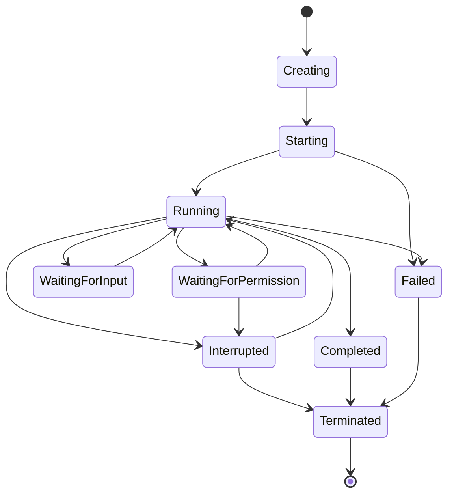

# Remote Coding Agent Management Platform
# Implementation Plan

**版本：** 1.0  
**日期：** 2026-11-13  
**对应架构文档：** `docs/architecture.md`  
**状态：** Implementation Proposal

---

# 1. 项目实施目标

## 1.1 总体目标

按照架构设计，构建一个可以通过 Web UI 远程管理多台 Machine 上 Coding Agent 的平台。

平台需要支持：

- 多 Machine 注册和连接。
- Claude Code、Codex、OpenCode 等 Coding Agent。
- 统一 Agent Session 管理。
- 实时 Agent 消息和事件传输。
- Agent 中断、恢复和关闭。
- Permission Request 与人工审批。
- 本地 Workspace 管理。
- 远程文件目录浏览和文件内容读取。
- Git Status 和 Git Diff。
- Workspace 文件变化实时通知。
- 多 Machine、多 Workspace、多 Session 管理。

## 1.2 实施约束

整个实施过程必须遵循以下约束。

### 架构约束

1. Agent Runtime 与 Workspace Service 必须独立。
2. Git Service 必须独立于 Agent Runtime。
3. Machine Agent Daemon 负责组合本地能力。
4. Control Plane 不运行 Coding Agent。
5. Control Plane 不保存完整 Workspace 文件内容。
6. Web UI 不直接依赖 Provider Native Protocol。
7. Workspace API 不依赖 Agent Prompt。
8. Agent Provider Adapter 不依赖 Control Plane。
9. Machine 与 Control Plane 之间的通信必须经过统一 Connection Protocol。
10. 所有跨模块数据交换使用 `core-protocol` 中定义的统一数据结构。

### 技术约束

| 模块 | 技术 |
|---|---|
| Agent Daemon | Rust |
| Control Plane | Rust |
| Web UI | React + TypeScript |
| Frontend Routing | TanStack Router |
| Frontend Data | TanStack Query |
| Code Editor | Monaco Editor |
| Local Database | SQLite |
| Control Plane Database | SQLite（初期） |
| Connection | WebSocket |
| Agent Protocol | Provider Native Protocol |
| Git | Git CLI |
| File Watcher | notify |
| Directory Traversal | ignore |
| API | REST + WebSocket |
| Serialization | JSON / JSONL |
| Multiplexing | Custom Lightweight Frame Protocol |

### 第一阶段不实现的能力

为了控制 MVP 范围，以下内容暂不作为第一阶段交付要求：

- Kubernetes 部署。
- 多实例 Control Plane。
- Redis / NATS 分布式连接路由。
- 多租户组织体系。
- Tailscale Direct Connection。
- Cloudflare Tunnel Provider。
- QUIC Transport。
- 多 Agent 自动协作。
- Agent Worktree 自动编排。
- Git Commit / Push / Pull 等完整 Git 写操作。
- 任意远程文件写入。
- 通用插件市场。

这些能力应保留扩展点，但不应阻碍核心链路交付。

---

# 2. 项目目录结构

最终 Monorepo 结构：

```text
agent-fleet/
│
├── apps/
│   ├── fleet-daemon/
│   ├── fleet-admin/
│   ├── fleet-cli/
│   └── web/
│
├── crates/
│   ├── core-protocol/
│   │   ├── src/
│   │   │   ├── lib.rs
│   │   │   ├── agent/
│   │   │   ├── machine/
│   │   │   ├── workspace/
│   │   │   ├── git/
│   │   │   └── connection/
│   │   └── Cargo.toml
│   │
│   ├── core-connection/
│   ├── daemon-runtime/
│   ├── daemon-workspace/
│   ├── daemon-git/
│   ├── admin-machine/
│   ├── admin-storage/
│   ├── daemon-storage/
│   ├── core-auth/
│   ├── admin-eventbus/
│   ├── daemon-process/
│   ├── core-config/
│   └── core-common/
│
├── packages/
│   ├── api-client/
│   ├── protocol-types/
│   └── ui/
│
├── migrations/
│   ├── fleet-admin/
│   └── agent-daemon/
│
├── scripts/
│   ├── dev/
│   ├── build/
│   └── test/
│
├── docs/
│   ├── architecture.md
│   ├── implementation-plan.md
│   ├── protocols.md
│   ├── security.md
│   └── development.md
│
├── Cargo.toml
├── package.json
├── pnpm-workspace.yaml
├── rust-toolchain.toml
└── README.md
```

## 2.1 Crate 职责

| Crate | 职责 | 依赖 |
|---|---|---|
| core-protocol | 统一协议和 DTO | core-common |
| core-connection | Machine 连接和反向隧道 | core-protocol, core-auth |
| daemon-runtime | Agent 生命周期和 Provider Adapter | core-protocol, daemon-process, daemon-storage |
| daemon-workspace | 文件系统、目录树和文件读取 | core-protocol, daemon-storage |
| daemon-git | Git 状态和 Diff | core-protocol, daemon-process |
| admin-machine | Machine 注册和连接状态 | core-protocol, admin-storage |
| admin-storage / daemon-storage | 按角色分割的 SQLite 持久化 | core-protocol, core-common |
| core-auth | 身份认证和授权 | core-common |
| admin-eventbus | Admin 浏览器事件分发 | core-protocol |
| daemon-process | 子进程管理 | core-common |
| core-config | 配置管理 | - |
| core-common | 通用错误、ID、时间、日志等 | - |

## 2.2 依赖方向

必须保持：

```text
                  core-common
                     |
                     v
                  core-protocol
                     |
        +------------+-------------+
        |            |             |
        v            v             v
 core-connection  daemon-runtime   daemon-workspace
                                  |
                                  v
                              daemon-git
        |
        +------------+-------------+
                     |
                     v
               agent-daemon
                     |
                     v
               agent-admin
```

说明：

- `daemon-workspace` 和 `daemon-git` 可以共享通用路径和进程管理能力，但不能互相形成业务依赖。
- `daemon-runtime` 不得直接依赖 `daemon-workspace` 或 `daemon-git`。
- `core-connection` 不得依赖具体 Provider Adapter。
- `core-protocol` 不得包含具体业务实现。
- `agent-admin` 通过 Protocol 和 Connection Gateway 访问 Machine 能力。

---

# 3. Phase 0：Monorepo 与工程基础设施

**目标：建立稳定的开发环境、工程规范和模块边界。**

## 3.1 初始化 Rust Workspace

创建根目录 `Cargo.toml`：

```toml
[workspace]
resolver = "2"

members = [
    "apps/fleet-daemon",
    "apps/fleet-admin",
    "crates/core-protocol",
    "crates/core-connection",
    "crates/daemon-runtime",
    "crates/daemon-workspace",
    "crates/daemon-git",
    "crates/admin-machine",
    "crates/admin-storage",
    "crates/daemon-storage",
    "crates/core-auth",
    "crates/admin-eventbus",
    "crates/daemon-process",
    "crates/core-config",
    "crates/core-common",
]
```

具体依赖版本统一由 Workspace 管理。

要求：

- 使用统一 Rust Toolchain。
- 使用统一 `rustfmt.toml`。
- 使用统一 `clippy.toml`。
- 所有 Crate 使用相同的错误处理规范。
- 所有 Crate 使用统一日志和 tracing 体系。
- 禁止循环依赖。

## 3.2 初始化前端 Workspace

使用 pnpm 管理：

```text
apps/web
packages/api-client
packages/protocol-types
packages/ui
```

要求：

- TypeScript strict mode。
- ESLint。
- Prettier。
- TanStack Router。
- TanStack Query。
- Tailwind CSS。
- Monaco Editor。
- OpenAPI TypeScript Client。

## 3.3 建立开发工具

建议提供：

```bash
pnpm dev
pnpm dev:daemon
pnpm dev
pnpm dev:web

pnpm test
pnpm test:rust
pnpm test:web

pnpm lint
pnpm fmt

pnpm build:rust
```

开发模式支持：

- 本地 Control Plane。
- 本地 Agent Daemon。
- 本地 Web UI。
- 一个或多个模拟 Machine。
- 模拟 Agent Provider。

## 3.4 建立测试基础设施

至少建立：

- Rust Unit Tests。
- Rust Integration Tests。
- Protocol Compatibility Tests。
- Web UI Tests。
- End-to-End Tests。

测试环境应提供 Mock Agent Provider 和 Mock Machine Connection。

## 3.5 Phase 0 验收

- [ ] Monorepo 可以正常构建。
- [ ] 所有 Crate 可以独立编译。
- [ ] Web UI 可以启动。
- [ ] CI 可以执行 Rust 和 TypeScript 检查。
- [ ] 测试框架已经建立。
- [ ] 文档和目录结构已经初始化。

---

# 4. Phase 1：Protocol 与基础数据模型

**目标：首先定义整个系统的协议契约，后续模块都围绕统一协议开发。**

这是所有业务模块的基础。

## 4.1 Protocol Crate

目录：

```text
crates/core-protocol/src/
├── lib.rs
├── common.rs
├── agent/
│   ├── mod.rs
│   ├── provider.rs
│   ├── session.rs
│   ├── turn.rs
│   ├── message.rs
│   ├── tool.rs
│   ├── permission.rs
│   └── event.rs
│
├── machine/
│   ├── mod.rs
│   ├── machine.rs
│   └── status.rs
│
├── workspace/
│   ├── mod.rs
│   ├── workspace.rs
│   ├── entry.rs
│   └── file.rs
│
├── git/
│   ├── mod.rs
│   ├── status.rs
│   └── diff.rs
│
└── connection/
    ├── mod.rs
    ├── envelope.rs
    ├── request.rs
    ├── response.rs
    ├── event.rs
    └── stream.rs
```

## 4.2 通用类型

定义：

```rust
pub type MachineId = String;
pub type WorkspaceId = String;
pub type ProjectId = String;
pub type SessionId = String;
pub type TurnId = String;
pub type EventId = String;
pub type MessageId = String;
pub type RequestId = String;
pub type StreamId = String;
```

后续可以根据需要替换为强类型 ID。

统一错误结构：

```rust
pub struct ApiError {
    pub code: String,
    pub message: String,
    pub details: Option<serde_json::Value>,
}
```

## 4.3 Agent 数据模型

实现：

- Provider
- AgentCapabilities
- AgentStartConfig
- AgentSession
- AgentTurn
- AgentMessage
- AgentToolCall
- AgentPermissionRequest
- AgentEvent

状态定义：

```rust
pub enum SessionStatus {
    Creating,
    Starting,
    Running,
    WaitingForInput,
    WaitingForPermission,
    Interrupted,
    Completed,
    Failed,
    Terminated,
}
```

Turn 状态：

```rust
pub enum TurnStatus {
    Pending,
    Running,
    Completed,
    Interrupted,
    Failed,
}
```

## 4.4 Workspace 数据模型

实现：

- Workspace
- WorkspaceEntry
- EntryType
- FileMetadata
- FileContent
- FileChangeEvent

## 4.5 Git 数据模型

实现：

- GitRepository
- GitBranch
- GitStatus
- GitFileStatus
- GitDiff
- DiffHunk
- DiffLine

## 4.6 Connection Envelope

统一消息封装：

```rust
pub struct ConnectionEnvelope {
    pub version: u16,
    pub stream_id: String,
    pub message_id: String,
    pub message_type: MessageType,
    pub method: Option<String>,
    pub payload: serde_json::Value,
}
```

消息类型：

```rust
pub enum MessageType {
    Request,
    Response,
    Event,
    Error,
}
```

Stream 消息单独定义：

```rust
pub enum StreamFrame {
    Open(StreamOpen),
    Chunk(StreamChunk),
    End(StreamEnd),
    Cancel(StreamCancel),
}
```

## 4.7 TypeScript 类型生成

建议从 Rust Protocol 生成 TypeScript 类型，或通过 OpenAPI Schema 生成 API Client。

要求：

- 前后端共享字段定义。
- 枚举保持一致。
- API Response 不允许手工重复定义。
- 协议升级时同步更新版本。

## 4.8 Phase 1 验收

- [ ] 所有核心对象已经定义。
- [ ] Agent、Workspace、Git 协议彼此独立。
- [ ] Connection Envelope 已定义。
- [ ] Rust 序列化测试通过。
- [ ] TypeScript 类型生成正常。
- [ ] 协议文档已生成。

---

# 5. Phase 2：Machine Agent Daemon 基础

**目标：构建运行在用户本地机器上的 Agent Daemon。**

此阶段先实现本地能力，不涉及远程连接。

## 5.1 Agent Daemon

目录：

```text
apps/fleet-daemon/
├── src/
│   ├── main.rs
│   ├── app.rs
│   ├── bootstrap.rs
│   ├── lifecycle.rs
│   ├── config.rs
│   └── services.rs
└── Cargo.toml
```

职责：

- 加载配置。
- 初始化日志。
- 初始化 SQLite。
- 初始化 Process Manager。
- 初始化 Agent Runtime。
- 初始化 Workspace Service。
- 初始化 Git Service。
- 初始化 Connection Client。
- 管理服务生命周期。

## 5.2 Process Manager

Crate：

```text
crates/daemon-process/
├── src/
│   ├── lib.rs
│   ├── process.rs
│   ├── command.rs
│   ├── environment.rs
│   ├── signal.rs
│   ├── output.rs
│   └── pty.rs
```

核心能力：

- 启动子进程。
- 管理 stdin/stdout/stderr。
- 记录 PID。
- 发送终止信号。
- 管理进程退出。
- 处理异常退出。
- 管理进程输出缓冲。
- 防止子进程孤儿化。

定义：

```rust
#[async_trait]
pub trait ManagedProcess: Send + Sync {
    async fn write_stdin(&self, data: &[u8]) -> Result<()>;

    async fn terminate(&self) -> Result<()>;

    async fn kill(&self) -> Result<()>;

    async fn wait(&self) -> Result<ExitStatus>;
}
```

需要区分：

- Pipe Process：适合结构化 JSONL 协议。
- PTY Process：适合终端交互兼容层。

不要默认所有 Agent 都使用 PTY。

## 5.3 Config Crate

实现：

- 配置文件读取。
- 环境变量覆盖。
- 默认配置。
- 配置校验。
- 配置热更新（后续）。

建议配置：

```toml
[machine]
name = "MacBook Pro"

[daemon]
host = "127.0.0.1"
port = 18080

[storage]
database = "~/.agent-fleet/agent.db"

[agent]
default_provider = "claude"

[workspace]
default_root = "~/Projects"
```

## 5.4 SQLite Storage

实现本地数据库初始化和迁移。

表：

```sql
CREATE TABLE machine_config (
    id TEXT PRIMARY KEY,
    name TEXT NOT NULL,
    private_key_ref TEXT,
    created_at TEXT NOT NULL
);

CREATE TABLE workspace_registry (
    id TEXT PRIMARY KEY,
    name TEXT NOT NULL,
    root_path TEXT NOT NULL,
    created_at TEXT NOT NULL
);

CREATE TABLE agent_sessions (
    id TEXT PRIMARY KEY,
    workspace_id TEXT,
    provider TEXT NOT NULL,
    status TEXT NOT NULL,
    cwd TEXT,
    created_at TEXT NOT NULL,
    updated_at TEXT NOT NULL
);
```

数据库访问必须封装在 Storage Crate 中。

业务模块不能自行创建独立 SQLite Connection 和 SQL Schema。

## 5.5 Phase 2 验收

- [ ] Daemon 可以正常启动。
- [ ] 可以读取和校验配置。
- [ ] SQLite 初始化和迁移正常。
- [ ] Process Manager 可以启动和管理子进程。
- [ ] Daemon 关闭时能够清理受管进程。
- [ ] 日志和错误处理统一。

---

# 6. Phase 3：Agent Runtime

**目标：实现统一 Agent 生命周期管理，并接入首批 Provider。**

## 6.1 Agent Runtime 内部结构

```text
crates/daemon-runtime/
├── src/
│   ├── lib.rs
│   ├── runtime.rs
│   ├── provider.rs
│   ├── session.rs
│   ├── event.rs
│   ├── capability.rs
│   ├── error.rs
│   │
│   ├── claude/
│   │   ├── mod.rs
│   │   ├── adapter.rs
│   │   ├── process.rs
│   │   ├── protocol.rs
│   │   ├── parser.rs
│   │   └── mapper.rs
│   │
│   ├── codex/
│   │   ├── mod.rs
│   │   ├── adapter.rs
│   │   ├── app_server.rs
│   │   ├── protocol.rs
│   │   └── mapper.rs
│   │
│   ├── opencode/
│   │   ├── mod.rs
│   │   ├── adapter.rs
│   │   ├── client.rs
│   │   └── mapper.rs
│   │
│   └── generic/
│       ├── mod.rs
│       ├── adapter.rs
│       └── terminal.rs
```

## 6.2 AgentProvider 接口

```rust
#[async_trait]
pub trait AgentProvider: Send + Sync {
    fn provider_id(&self) -> &'static str;

    fn capabilities(&self) -> AgentCapabilities;

    async fn start(
        &self,
        config: AgentStartConfig,
    ) -> Result<AgentSession>;

    async fn send_message(
        &self,
        session_id: &str,
        message: AgentMessage,
    ) -> Result<()>;

    async fn interrupt(
        &self,
        session_id: &str,
    ) -> Result<()>;

    async fn resume(
        &self,
        session_id: &str,
    ) -> Result<()>;

    async fn shutdown(
        &self,
        session_id: &str,
    ) -> Result<()>;
}
```

事件流可以通过统一的 Event Stream 接口暴露，不必将 `next_event` 强行实现为所有 Provider 的阻塞式方法。

例如：

```rust
pub type AgentEventStream =
    Pin<Box<dyn Stream<Item = Result<AgentEvent>> + Send>>;
```

## 6.3 Runtime 管理器

Runtime 负责：

- Provider Registry。
- Session Registry。
- Session 生命周期。
- Provider 实例选择。
- 统一事件分发。
- Session 元数据持久化。
- Provider Capability 查询。

定义：

```rust
pub struct AgentRuntime {
    providers: ProviderRegistry,
    sessions: SessionRegistry,
    event_bus: AgentEventBus,
}
```

## 6.4 Claude Code Adapter

### 实施任务

1. 检查本机 Claude Code CLI 是否存在。
2. 获取 CLI 版本。
3. 验证目标版本支持的 Streaming JSON 参数。
4. 实现 Process 启动。
5. 实现 JSONL 输入输出解析。
6. 实现 Agent Event Mapper。
7. 实现 Session 创建。
8. 实现消息发送。
9. 实现中断。
10. 实现 Session Resume（如果目标模式支持）。
11. 实现 Permission Event 适配。
12. 实现异常退出处理。

### 实现要求

将原始 JSONL 消息与统一事件模型分开。

```text
Claude JSONL
     |
     v
Claude Parser
     |
     v
Claude Native Event
     |
     v
Claude Mapper
     |
     v
Unified Agent Event
```

需要特别验证 CLI 的持续输入和中断能力。

如果当前 CLI 模式不能满足完整双向交互，记录能力差异，不要伪造支持。

### SDK Worker 备用路径

如果 CLI 的交互能力不足，可以实现：

```text
Rust Agent Daemon
       |
       | JSON-RPC over stdio
       |
TypeScript SDK Worker
       |
       v
Claude Agent SDK
```

Worker 只负责 Claude SDK 适配。

Agent Session 的统一生命周期仍然由 Rust Agent Runtime 管理。

## 6.5 Codex Adapter

### 实施任务

1. 检查 Codex CLI 是否存在。
2. 检查 App Server 能力和版本。
3. 启动 `codex app-server --listen stdio://`。
4. 建立 JSON-RPC 2.0 通信。
5. 实现 Request ID 管理。
6. 实现 Notification 处理。
7. 实现 Thread 创建和管理。
8. 实现 Turn 创建和管理。
9. 实现 Message Delta 映射。
10. 实现 Tool Call 映射。
11. 实现 Permission Event 映射。
12. 实现中断和恢复。
13. 实现进程退出和错误处理。

协议 Schema 应从目标 Codex 版本生成。

不应手工猜测或长期维护不匹配的 Provider Schema。

## 6.6 OpenCode Adapter

### 实施任务

1. 确认 OpenCode Server 启动方式。
2. 实现 Server Client。
3. 实现 Session 管理。
4. 实现消息发送。
5. 实现事件订阅。
6. 实现事件转换。
7. 实现错误和断线处理。

具体使用 HTTP、SSE 或 WebSocket，以实际目标版本的 Server API 能力为准。

## 6.7 Generic CLI Adapter

作为兼容性能力：

- PTY 创建。
- stdin 写入。
- stdout/stderr 读取。
- 终端输出事件。
- 进程状态管理。
- Session 关闭。

不要求第一阶段解析所有 Tool Call 和 Permission。

## 6.8 Provider Registry

实现：

```rust
pub struct ProviderRegistry {
    providers: HashMap<String, Arc<dyn AgentProvider>>,
}
```

支持：

```text
claude
codex
opencode
generic
```

## 6.9 Session 生命周期

状态流转：



需要定义非法状态转换和并发状态更新保护。

## 6.10 Phase 3 验收

- [ ] 可以注册多个 Provider。
- [ ] 可以启动 Claude Code Session。
- [ ] 可以启动 Codex Session。
- [ ] 可以发送用户消息。
- [ ] 可以实时接收结构化事件。
- [ ] 可以中断 Agent。
- [ ] 可以关闭 Session。
- [ ] Provider 能力正确声明。
- [ ] 原生事件映射测试通过。
- [ ] Agent 进程异常退出不会导致 Daemon 崩溃。
- [ ] Session 元数据能够持久化。

---

# 7. Phase 4：Workspace Service

**目标：实现 Machine 本地文件系统管理能力。**

此阶段不依赖 Agent Runtime。

## 7.1 Workspace Crate

```text
crates/daemon-workspace/
├── src/
│   ├── lib.rs
│   ├── service.rs
│   ├── registry.rs
│   ├── filesystem.rs
│   ├── directory_index.rs
│   ├── directory_reader.rs
│   ├── file_reader.rs
│   ├── file_metadata.rs
│   ├── file_watcher.rs
│   ├── path_policy.rs
│   ├── ignore_rules.rs
│   └── error.rs
```

## 7.2 Workspace Registry

实现：

- Workspace 注册。
- Workspace 查询。
- Workspace 删除。
- Root Path 校验。
- Workspace 元数据持久化。
- Workspace 与 Project 关联。

注册流程：

1. 接收 Workspace Root。
2. 验证目录存在。
3. 验证目录可访问。
4. 规范化 Root Path。
5. 检测是否为 Git Repository。
6. 创建 Workspace ID。
7. 写入 SQLite。

禁止未经授权注册任意系统路径。

## 7.3 Path Policy

这是必须优先完成的安全模块。

实现：

- 相对路径规范化。
- `..` 拒绝。
- 绝对路径拒绝。
- 符号链接检查。
- Root Directory 边界检查。
- 文件类型检查。
- 文件大小限制。

需要考虑 TOCTOU 风险。

对于安全要求较高的场景，使用平台支持的目录句柄相对访问方式，避免仅依赖路径字符串校验后再打开文件。

测试用例：

```text
src/lib.rs                 Allowed
src/agent/runtime.rs       Allowed
../../.ssh/id_rsa          Denied
/etc/passwd                Denied
symlink-outside/file       Denied
```

## 7.4 Directory Index

使用 `ignore` crate 进行目录遍历。

实现：

- 根目录初始扫描。
- 子目录懒加载。
- Ignore Rules。
- Git Ignore 读取。
- 隐藏文件过滤。
- 文件元数据缓存。
- 分页。

SQLite：

```sql
CREATE TABLE workspace_entries (
    id INTEGER PRIMARY KEY,
    workspace_id TEXT NOT NULL,
    parent_id INTEGER,
    path TEXT NOT NULL,
    name TEXT NOT NULL,
    entry_type TEXT NOT NULL,
    size INTEGER,
    mtime_ns INTEGER,
    inode INTEGER,
    ignored INTEGER NOT NULL DEFAULT 0,
    UNIQUE(workspace_id, path)
);

CREATE INDEX idx_workspace_parent
ON workspace_entries(workspace_id, parent_id);
```

实现增量更新接口：

```rust
async fn invalidate_path(
    workspace_id: &str,
    path: &str,
) -> Result<()>;
```

## 7.5 Directory Tree API

实现：

```rust
async fn list_directory(
    workspace_id: &str,
    path: &str,
    cursor: Option<String>,
    limit: usize,
) -> Result<DirectoryListing>;
```

必须支持：

- 分页。
- 稳定排序。
- 文件夹和文件区分。
- 忽略规则。
- 权限检查。

## 7.6 File Reader

实现：

```rust
async fn read_file(
    workspace_id: &str,
    path: &str,
) -> Result<FileContent>;
```

支持：

- UTF-8 文件读取。
- 二进制检测。
- 文件大小限制。
- ETag。
- 文件修改时间。
- 大文件拒绝或分块读取。
- 读取取消。

文件读取不能经过 Agent Runtime。

## 7.7 File Watcher

使用 `notify`。

实现：

- Workspace Root Watch。
- 文件变化监听。
- 事件去重。
- Debounce。
- 目录级事件聚合。
- 缓存失效。
- 变化事件发布。
- 定期目录校准。

建议 Watcher 和目录扫描逻辑分开。

Watcher 负责发现变化，Directory Index 负责更新缓存。

## 7.8 Phase 4 验收

- [ ] 可以注册 Workspace。
- [ ] 可以列出 Workspace。
- [ ] 可以懒加载目录树。
- [ ] 可以读取文件内容。
- [ ] ETag 缓存正常。
- [ ] 可以识别二进制文件。
- [ ] 路径穿越测试通过。
- [ ] 符号链接逃逸测试通过。
- [ ] 文件变化可以被监听。
- [ ] 目录索引可以增量更新。
- [ ] 定期校准可以恢复索引一致性。

---

# 8. Phase 5：Git Service

**目标：实现基于本地 Git Repository 的状态和 Diff 服务。**

## 8.1 Git Service Crate

```text
crates/daemon-git/
├── src/
│   ├── lib.rs
│   ├── service.rs
│   ├── repository.rs
│   ├── discovery.rs
│   ├── command.rs
│   ├── status.rs
│   ├── parser/
│   │   ├── mod.rs
│   │   └── porcelain_v2.rs
│   ├── diff.rs
│   ├── diff_parser.rs
│   ├── branches.rs
│   ├── history.rs
│   └── error.rs
```

## 8.2 Repository Discovery

实现：

- Workspace Root 检测。
- Git Repository 检测。
- Git Worktree 检测。
- `.git` 文件与目录处理。
- Git CLI 版本检测。

不能简单假设 `.git` 一定是目录。

Worktree 中 `.git` 可能是一个文件。

## 8.3 Git Command Runner

通过 Process Manager 或专用命令执行层运行 Git CLI。

必须：

- 固定命令参数。
- 禁止拼接用户提供的 Shell 命令。
- 使用参数数组。
- 设置工作目录。
- 限制执行时间。
- 限制输出大小。
- 处理非 UTF-8 路径。

所有 Git 操作都应该绑定已注册的 Workspace。

## 8.4 Git Status

运行：

```bash
git status --porcelain=v2 -z --branch
```

实现完整解析：

- Branch
- Ahead / Behind
- Modified
- Added
- Deleted
- Renamed
- Copied
- Untracked
- Staged / Unstaged
- Conflict

注意：

Git 路径可能包含空格、换行符和非 UTF-8 字节。

解析器应尽量保留原始路径表示，并对无法安全转换成 Unicode 的路径给出明确处理策略。

## 8.5 Git Diff

实现：

```bash
git diff
git diff --cached
git diff BASE..HEAD
git diff -- path
```

定义 Diff Service：

```rust
async fn get_diff(
    workspace_id: &str,
    options: GitDiffOptions,
) -> Result<GitDiff>;
```

支持：

- 工作区 Diff。
- Staged Diff。
- 指定文件 Diff。
- Commit Range Diff。
- Diff Summary。
- Binary Detection。

## 8.6 Untracked Files

实现 Untracked File Diff。

流程：

1. 从 Git Status 获取 Untracked 文件。
2. 使用 Path Policy 校验。
3. 检查文件类型和大小。
4. 读取文件内容。
5. 生成统一新增 Diff。
6. 对二进制文件返回 Binary 标记。

## 8.7 Diff Parser

解析 Unified Diff：

- File Header
- Hunk Header
- Context Line
- Added Line
- Deleted Line

输出统一 Diff Model。

注意保留：

- 原始行号。
- 文件重命名信息。
- 文件模式变化。
- 二进制状态。

## 8.8 Git Status Cache

Git Status 不应该在每一个文件系统事件后立即重新执行。

实现：

- Debounce。
- Batch Refresh。
- Status Cache。
- Manual Refresh。
- 定期校准。

当大量文件变化时，将多个事件合并成一次 Git Status 更新。

## 8.9 Phase 5 验收

- [ ] 可以识别 Git Repository。
- [ ] 可以正确解析 Porcelain v2。
- [ ] 可以展示 Branch。
- [ ] 可以展示 Ahead / Behind。
- [ ] 可以识别 Staged 和 Unstaged。
- [ ] 可以展示 Untracked 文件。
- [ ] 可以获取文件 Diff。
- [ ] 可以获取 Diff Summary。
- [ ] 可以处理 Binary 文件。
- [ ] Git Status 更新有 Debounce。
- [ ] Git CLI 异常不会影响 Daemon。

---

# 9. Phase 6：Connection Gateway 与 Reverse Connection

**目标：实现 Machine 与 Control Plane 的远程双向通信。**

## 9.1 Connection Gateway

```text
crates/core-connection/
├── src/
│   ├── lib.rs
│   ├── client.rs
│   ├── server.rs
│   ├── connection.rs
│   ├── reverse_tunnel.rs
│   ├── multiplexing.rs
│   ├── heartbeat.rs
│   ├── routing.rs
│   ├── registry.rs
│   ├── stream.rs
│   └── error.rs
```

## 9.2 Machine Connection Client

Daemon 侧实现：

- Control Plane 地址配置。
- TLS 连接。
- Machine 身份认证。
- WebSocket 建立。
- 心跳。
- 重连。
- 断线状态处理。
- 消息发送和接收。

建议连接状态：

```rust
pub enum ConnectionState {
    Disconnected,
    Connecting,
    Authenticating,
    Connected,
    Reconnecting,
    Failed,
}
```

## 9.3 Machine Identity

实现 Ed25519 Machine Identity。

需要支持：

- 首次生成密钥。
- 私钥本地安全保存。
- 公钥注册。
- Machine ID 关联。
- Challenge / Response。
- 身份吊销。
- 密钥轮换预留接口。

首次注册应通过明确的用户授权流程。

不要让任意首次连接的 Machine 自动获得账户访问权限。

## 9.4 Control Plane Connection Gateway

实现：

- WebSocket Endpoint。
- Machine Authentication。
- Connection Registry。
- Heartbeat Validation。
- Connection State Tracking。
- Disconnect Handling。
- Request Routing。

连接注册信息：

```rust
pub struct MachineConnectionInfo {
    pub machine_id: MachineId,
    pub connection_id: String,
    pub connected_at: DateTime<Utc>,
    pub last_seen_at: DateTime<Utc>,
}
```

## 9.5 Multiplexing

实现逻辑 Stream：

```text
Agent Commands
Agent Events
Workspace Requests
Git Requests
Health
```

每个请求包含：

- Request ID。
- Stream ID。
- Method。
- Payload。
- Timeout。

每个响应必须能够关联到原始请求。

## 9.6 Stream Transfer

实现：

- Stream Open。
- Stream Chunk。
- Stream End。
- Stream Cancel。

对于大型文件和大型 Diff，不应将全部内容作为单个 JSON WebSocket 消息传输。

优先使用：

- HTTP Streaming。
- 或 WebSocket Binary Frame 分块传输。

如果采用 WebSocket Binary Frame，需要定义明确的帧头、长度、版本和消息关联信息。

必须支持：

- 最大 Frame 大小。
- 最大并发 Stream。
- Backpressure。
- 取消。
- 超时。
- 分块顺序校验。

## 9.7 Reconnect

实现：

- Exponential Backoff。
- 最大重连间隔。
- 网络恢复检测。
- 认证过期处理。
- 连接状态更新。
- 未完成请求失败处理。

不要在连接断开后盲目重放所有请求。

请求应根据操作语义区分：

- 可安全重试的只读请求。
- 需要幂等键的写请求。
- 不允许自动重放的命令。

## 9.8 Phase 6 验收

- [ ] Machine 能主动连接 Control Plane。
- [ ] Machine Identity 认证正常。
- [ ] Heartbeat 正常。
- [ ] 断线后自动重连。
- [ ] Control Plane 能找到 Machine Connection。
- [ ] Request / Response 正确关联。
- [ ] 多个 Stream 可以并行工作。
- [ ] 大型数据可以分块传输。
- [ ] Stream 可以取消。
- [ ] 未授权 Machine 无法建立有效连接。

---

# 10. Phase 7：Control Plane

**目标：构建统一远程管理 API 和事件路由服务。**

## 10.1 Control Plane 结构

```text
apps/fleet-admin/
├── src/
│   ├── main.rs
│   ├── app.rs
│   ├── state.rs
│   ├── routes/
│   │   ├── mod.rs
│   │   ├── machines.rs
│   │   ├── projects.rs
│   │   ├── workspaces.rs
│   │   ├── agents.rs
│   │   ├── sessions.rs
│   │   ├── permissions.rs
│   │   └── events.rs
│   │
│   ├── services/
│   │   ├── machine_service.rs
│   │   ├── workspace_service.rs
│   │   ├── git_service.rs
│   │   ├── agent_service.rs
│   │   └── event_service.rs
│   │
│   ├── middleware/
│   │   ├── auth.rs
│   │   ├── permission.rs
│   │   └── request_id.rs
│   │
│   └── error.rs
└── Cargo.toml
```

## 10.2 Control Plane 数据库

初期采用 SQLite。

迁移目录：

```text
crates/admin-storage/migrations/
└── 0001_admin.sql
```

建议表：

```text
users
machines
machine_connections
projects
workspaces
agent_sessions
agent_turns
agent_messages
agent_events
permission_requests
audit_logs
```

Machine 活跃连接本身保存在内存 Registry 中。

数据库保存 Machine 元数据、最后在线时间和必要的连接状态记录。

## 10.3 Machine API

实现：

```http
GET    /api/v1/machines
GET    /api/v1/machines/:id
POST   /api/v1/machines/:id/reconnect
DELETE /api/v1/machines/:id
```

要求：

- 机器列表。
- 机器详情。
- 在线状态。
- 最近心跳。
- Agent Daemon 版本。
- 支持的 Provider。
- Workspace 数量。

## 10.4 Project / Workspace API

实现：

```http
GET    /api/v1/projects
POST   /api/v1/projects
GET    /api/v1/projects/:id
PATCH  /api/v1/projects/:id
DELETE /api/v1/projects/:id

GET    /api/v1/workspaces
POST   /api/v1/workspaces
GET    /api/v1/workspaces/:id
DELETE /api/v1/workspaces/:id
```

Workspace 远程请求必须先校验用户是否有权访问所属 Machine。

## 10.5 Agent API

实现：

```http
GET    /api/v1/agents
GET    /api/v1/sessions
POST   /api/v1/sessions
GET    /api/v1/sessions/:id

POST   /api/v1/sessions/:id/messages
POST   /api/v1/sessions/:id/interrupt
POST   /api/v1/sessions/:id/resume
DELETE /api/v1/sessions/:id
```

请求处理：

```text
Browser
   |
   v
Control Plane API
   |
   v
Authentication
   |
   v
Authorization
   |
   v
Session Registry
   |
   v
Machine Router
   |
   v
Machine Connection
   |
   v
Agent Daemon
```

## 10.6 Workspace / Git API 代理

实现：

```http
GET /api/v1/workspaces/:id/tree
GET /api/v1/workspaces/:id/files
GET /api/v1/workspaces/:id/search

GET /api/v1/workspaces/:id/git/status
GET /api/v1/workspaces/:id/git/diff
GET /api/v1/workspaces/:id/git/branches
GET /api/v1/workspaces/:id/git/log
```

Control Plane 只负责：

- 用户授权。
- Workspace 与 Machine 路由。
- 请求超时。
- 传输数据。
- 响应处理。

不负责在云端建立完整文件索引。

## 10.7 Event Gateway

建立一个统一的 WebSocket Endpoint：

```text
WS /api/v1/events
```

事件来源：

- Machine Connection Gateway。
- Agent Runtime。
- Workspace Service。
- Git Service。

事件处理：

1. 接收 Machine 事件。
2. 验证 Machine 身份。
3. 验证事件来源。
4. 根据 Session / Workspace / Machine 找到订阅者。
5. 执行用户授权过滤。
6. 推送到 Browser。

事件需要包含稳定 ID 和顺序信息。

对于需要可靠恢复的事件，前端可以通过 `sequence` 请求补充历史数据。

## 10.8 Permission API

实现：

```http
GET  /api/v1/sessions/:id/permissions

POST /api/v1/permissions/:id/approve
POST /api/v1/permissions/:id/reject
```

审批过程：

1. Agent Provider 产生 Permission Request。
2. Machine Daemon 将事件发送 Control Plane。
3. Control Plane 保存请求状态。
4. Web UI 展示审批界面。
5. 用户审批。
6. Control Plane 校验权限。
7. 将结果发送 Machine。
8. Agent Adapter 调用 Provider 原生审批机制。
9. 更新 Permission 状态。

需要处理：

- 请求超时。
- 重复审批。
- Session 已关闭。
- Machine 离线。
- 审批结果无法送达。

## 10.9 Phase 7 验收

- [ ] Control Plane 可以启动。
- [ ] Machine 可以注册。
- [ ] Machine 列表正常。
- [ ] Machine 路由正常。
- [ ] Agent API 正常。
- [ ] Workspace API 正常。
- [ ] Git API 正常。
- [ ] WebSocket Event 正常。
- [ ] Permission Approval 正常。
- [ ] 用户无法访问未授权 Machine。

---

# 11. Phase 8：Web UI

**目标：实现完整的远程 Coding Agent 使用界面。**

## 11.1 前端目录

```text
apps/web/src/
├── app/
│   ├── main.tsx
│   ├── router.tsx
│   └── providers.tsx
│
├── features/
│   ├── machines/
│   ├── projects/
│   ├── workspaces/
│   ├── agents/
│   ├── sessions/
│   ├── permissions/
│   ├── files/
│   └── git/
│
├── components/
│   ├── layout/
│   ├── editor/
│   ├── diff/
│   ├── terminal/
│   ├── status/
│   └── dialogs/
│
├── lib/
│   ├── api/
│   ├── events/
│   ├── query/
│   └── utils/
│
└── styles/
```

## 11.2 API Client

使用统一 API Client。

要求：

- 统一请求错误处理。
- 自动注入用户认证信息。
- Request ID。
- Timeout。
- AbortSignal。
- 类型安全。
- WebSocket 重连。
- Event Subscription。

## 11.3 TanStack Query

定义 Query Key：

```ts
const queryKeys = {
  machines: ["machines"],
  machine: (id: string) => ["machines", id],

  workspaces: ["workspaces"],
  workspace: (id: string) => ["workspaces", id],

  tree: (id: string, path: string) =>
    ["workspaces", id, "tree", path],

  file: (id: string, path: string) =>
    ["workspaces", id, "file", path],

  gitStatus: (id: string) =>
    ["workspaces", id, "git", "status"],

  gitDiff: (id: string, path: string) =>
    ["workspaces", id, "git", "diff", path],

  sessions: ["sessions"],
  session: (id: string) => ["sessions", id],
};
```

## 11.4 Machine Dashboard

实现：

- Machine 列表。
- 在线状态。
- 最后心跳。
- Daemon 版本。
- Provider 列表。
- Workspace 数量。
- 连接错误状态。

## 11.5 Workspace Explorer

实现：

- 左侧目录树。
- 目录懒加载。
- 文件搜索。
- 文件打开。
- 文件内容缓存。
- 文件变化提示。

不要在首次打开 Workspace 时加载全部文件内容。

## 11.6 Code Editor

使用 Monaco Editor。

支持：

- Rust。
- TypeScript。
- JavaScript。
- JSON。
- Markdown。
- TOML。
- YAML。
- 常见代码语言。

第一阶段只要求只读预览。

文件编辑和写回能力作为后续独立安全功能设计。

## 11.7 Git Changes Panel

实现：

- Current Branch。
- Ahead / Behind。
- Modified Files。
- Staged Files。
- Untracked Files。
- Added / Deleted Counts。
- File Diff。

用户展开文件时再请求完整 Diff。

## 11.8 Agent Session UI

实现：

- Session 创建。
- Session 切换。
- Message Composer。
- Message Streaming。
- Tool Call 展示。
- Agent Status。
- Interrupt。
- Resume。
- Session History。

Agent 消息应支持增量渲染。

不要因为每一个 Delta 都触发整个页面重新渲染。

## 11.9 Permission Approval UI

实现：

- Permission Request 列表。
- 请求描述。
- Tool Name。
- 相关参数。
- Approve。
- Reject。
- Timeout 状态。
- Session 失效状态。

必须清晰区分：

- 已审批。
- 已拒绝。
- 已超时。
- 已取消。
- 已无法送达。

## 11.10 实时事件处理

统一事件订阅：

```ts
interface EventClient {
  connect(): Promise<void>;
  disconnect(): Promise<void>;

  subscribe(
    eventType: string,
    handler: (event: PlatformEvent) => void
  ): () => void;
}
```

收到事件后：

- 更新 Agent Message。
- 更新 Tool Call。
- 更新 Permission。
- 刷新 Workspace Tree。
- 刷新 Git Status。
- 提示文件外部变化。

对于文件正在编辑的场景，不能静默覆盖本地编辑缓冲。

## 11.11 Phase 8 验收

- [ ] Machine Dashboard 正常。
- [ ] Workspace Explorer 正常。
- [ ] Monaco Editor 正常。
- [ ] Git Changes Panel 正常。
- [ ] Monaco Diff Editor 正常。
- [ ] Agent Message Streaming 正常。
- [ ] Tool Call 正常。
- [ ] Permission Approval 正常。
- [ ] WebSocket 断线后可以恢复。
- [ ] 事件不会导致明显的 UI 卡顿。

---

# 12. Phase 9：端到端集成

**目标：验证从浏览器到 Machine 的完整业务链路。**

## 12.1 E2E 场景一：连接 Machine

```text
启动 Agent Daemon
      |
      v
连接 Control Plane
      |
      v
Machine Authentication
      |
      v
Connection Registry
      |
      v
Browser Machine Dashboard
```

验收：

- Machine 可以上线。
- 浏览器能看到 Machine。
- Machine 离线后状态能够更新。
- Machine 恢复后自动重新上线。

## 12.2 E2E 场景二：启动 Coding Agent

```text
Browser
  |
  v
Create Session
  |
  v
Control Plane
  |
  v
Machine Router
  |
  v
Agent Daemon
  |
  v
Agent Runtime
  |
  v
Claude Code / Codex
```

验收：

- 能创建 Session。
- 能指定 Workspace。
- Agent 的 cwd 正确。
- Session 状态正确。
- Agent 输出能够实时展示。

## 12.3 E2E 场景三：Agent 实时消息

验收：

- 浏览器发送消息。
- Machine 收到请求。
- Provider 收到输入。
- Agent 产生 Delta。
- Control Plane 接收事件。
- 浏览器实时展示。
- Event Sequence 正确。

## 12.4 E2E 场景四：Workspace 浏览

验收：

- 浏览器请求目录树。
- Control Plane 路由到正确 Machine。
- Machine 返回目录内容。
- 浏览器展开子目录。
- 浏览器打开文件。
- 文件内容与本地一致。
- 未授权路径无法访问。

## 12.5 E2E 场景五：Git Diff

验收：

1. Agent 修改本地文件。
2. Watcher 发现变化。
3. Git Service 更新状态。
4. Browser 收到事件。
5. Git Changes Panel 更新。
6. 用户展开文件。
7. 浏览器获取完整 Diff。
8. Monaco Diff Editor 正确展示。

## 12.6 E2E 场景六：Permission Approval

验收：

1. Agent 发出权限请求。
2. 浏览器显示审批界面。
3. 用户批准或拒绝。
4. 结果返回 Machine。
5. Provider Adapter 执行对应操作。
6. Session 继续运行或按拒绝策略处理。

---

# 13. Phase 10：稳定性、安全和性能

## 13.1 网络稳定性

测试：

- Machine 断网。
- Control Plane 重启。
- WebSocket 异常关闭。
- Machine 休眠。
- 网络切换。
- DNS 故障。
- TLS 证书异常。
- 长时间连接。

要求：

- 自动重连。
- 不重复执行不可重放命令。
- 连接状态准确。
- 未完成请求有明确失败状态。

## 13.2 Agent 稳定性

测试：

- Agent CLI 不存在。
- Provider 版本不兼容。
- Agent 启动失败。
- Agent 崩溃。
- stdout 异常关闭。
- JSONL 消息损坏。
- 超长输出。
- Session 中断。
- Session 恢复失败。

## 13.3 Workspace 安全

测试：

- `../` 路径穿越。
- 绝对路径访问。
- 符号链接逃逸。
- 大文件读取。
- 二进制文件读取。
- 非 UTF-8 文件名。
- 文件被删除。
- 文件被替换。
- 并发读取。
- Workspace 被注销。

## 13.4 Git 稳定性

测试：

- 非 Git 目录。
- Git Worktree。
- Untracked 文件。
- 文件重命名。
- 文件删除。
- Conflict。
- Submodule。
- Git LFS。
- 非 UTF-8 文件名。
- 大型 Diff。
- Binary Diff。
- Git CLI 异常退出。

## 13.5 性能测试

至少测试：

| 场景 | 测试目标 |
|---|---|
| 多 Session | 多个 Agent Session 并行 |
| 多 Machine | 多个 Machine 同时连接 |
| 事件流 | 高频 Agent Delta |
| 文件树 | 大型 Repository |
| Git Status | 大型 Git Repository |
| Git Diff | 大型 Diff |
| 文件读取 | 大文件传输 |
| Watcher | 大量文件变化 |
| 连接恢复 | 大量 Machine 同时重连 |

具体性能阈值应在目标机器和部署环境上通过基准测试确定，不在架构阶段凭空设定。

---

# 14. 数据库迁移计划

## 14.1 Control Plane

建议按功能拆分迁移：

```text
crates/admin-storage/migrations/
└── 0001_admin.sql
```

Admin owns machines, workspace/session metadata, permission routing, audit,
organizations, users and machine ownership. It has no transcript tables.

## 14.2 Machine Daemon

```text
crates/daemon-storage/migrations/
└── 0001_daemon.sql
```

Daemon owns workspaces, the directory index, sessions, turns, messages, tool
calls and permissions. It has no organization/user/audit tables.

## 14.3 数据一致性原则

- 所有迁移必须可追踪。
- 不允许在运行过程中随意修改 Schema。
- 缓存数据允许重建。
- 文件系统是 Workspace 内容的权威来源。
- Git Repository 是 Git 状态的权威来源。
- Provider 是 Agent 原生状态的权威来源。
- Session 元数据需要定义本地和 Control Plane 的同步策略。

对于 SQLite：

- 使用合理的事务边界。
- 明确 WAL 模式的适用场景。
- 配置 Busy Timeout。
- 控制并发写入。
- 不要让多个组件无协调地争抢写连接。

---

# 15. 测试计划

## 15.1 Unit Tests

每个 Crate 都需要独立单元测试。

| Crate | 重点 |
|---|---|
| core-protocol | 序列化、反序列化、版本兼容 |
| daemon-process | 进程生命周期、输出和信号 |
| daemon-runtime | Session 状态、事件映射 |
| core-connection | Frame、Stream、Request Routing |
| daemon-workspace | Path Policy、目录树、文件读取 |
| daemon-git | Porcelain 和 Diff Parser |
| admin-storage / daemon-storage | Migration、事务和查询 |
| core-auth | Machine 身份与用户权限 |
| admin-eventbus | Admin 浏览器事件分发和订阅 |

## 15.2 Integration Tests

至少建立：

```text
tests/
├── agent/
│   ├── claude_session.rs
│   └── codex_session.rs
│
├── connection/
│   ├── machine_connect.rs
│   ├── reconnect.rs
│   └── multiplexing.rs
│
├── workspace/
│   ├── directory_tree.rs
│   ├── file_read.rs
│   └── path_security.rs
│
├── git/
│   ├── status.rs
│   ├── diff.rs
│   └── untracked.rs
│
└── e2e/
    ├── remote_agent.rs
    ├── workspace_browser.rs
    └── git_diff.rs
```

## 15.3 Mock Provider

必须提供 Mock Agent Provider。

用途：

- 前端开发。
- Connection Gateway 测试。
- Agent Event 测试。
- Permission 测试。
- E2E 测试。

Mock Provider 应支持：

- 模拟启动。
- 模拟 Message Delta。
- 模拟 Tool Call。
- 模拟 Permission Request。
- 模拟中断。
- 模拟失败。
- 模拟延迟。

不要让所有自动化测试都依赖真实 Claude Code 或 Codex。

## 15.4 Protocol Compatibility Tests

对每一个 Provider：

- 保存脱敏的原始协议样例。
- 对 Parser 做 Fixture Tests。
- 对 Mapper 做 Golden Tests。
- 针对支持版本执行兼容测试。

Provider 升级时，应先更新 Fixture 和 Schema，再修改 Adapter。

---

# 16. 里程碑与交付顺序

建议严格按照以下依赖顺序推进。

| 里程碑 | 阶段 | 主要交付 |
|---|---|---|
| M0 | Phase 0 | Monorepo 和开发环境 |
| M1 | Phase 1 | Protocol 和统一数据模型 |
| M2 | Phase 2 | Agent Daemon 基础 |
| M3 | Phase 3 | Agent Runtime 和首批 Provider |
| M4 | Phase 4 | Workspace Service |
| M5 | Phase 5 | Git Service |
| M6 | Phase 6 | Reverse Connection |
| M7 | Phase 7 | Control Plane |
| M8 | Phase 8 | Web UI |
| M9 | Phase 9 | E2E 集成 |
| M10 | Phase 10 | 稳定性、安全和性能 |

注意：Phase 4、Phase 5 可以与 Phase 3 并行开发，因为 Workspace 和 Git 不依赖 Agent Runtime。

Phase 6 可以在 Phase 2 和 Phase 1 完成后启动。

Phase 7 依赖 Protocol 和 Connection Gateway 的核心接口。

Phase 8 可以在 API 契约稳定后提前开发 Mock UI，但最终联调依赖 Phase 7。

---

# 17. MVP 范围与完成定义

## 17.1 MVP 必须包含

### Machine

- [ ] Machine 注册。
- [ ] Machine Identity。
- [ ] Reverse Connection。
- [ ] Heartbeat。
- [ ] Reconnect。
- [ ] 在线状态。

### Agent

- [ ] Claude Code Adapter。
- [ ] Codex Adapter。
- [ ] Session 创建。
- [ ] 消息发送。
- [ ] 实时输出。
- [ ] Interrupt。
- [ ] Shutdown。
- [ ] 基础事件模型。

### Workspace

- [ ] Workspace 注册。
- [ ] 目录树懒加载。
- [ ] 文件内容读取。
- [ ] 路径安全。
- [ ] 文件变化通知。

### Git

- [ ] Git Status。
- [ ] Branch。
- [ ] Untracked Files。
- [ ] Diff Summary。
- [ ] File Diff。

### Control Plane

- [ ] Machine API。
- [ ] Agent API。
- [ ] Workspace API。
- [ ] Git API。
- [ ] Event Gateway。
- [ ] 基础用户授权。

### Web UI

- [ ] Machine Dashboard。
- [ ] Workspace Explorer。
- [ ] Agent Session 页面。
- [ ] Message Streaming。
- [ ] Monaco Editor。
- [ ] Git Changes Panel。
- [ ] Monaco Diff Editor。

## 17.2 MVP 暂不要求

- [ ] 多实例 Control Plane。
- [ ] Redis / NATS。
- [ ] 多租户组织管理。
- [ ] Cloudflare Tunnel。
- [ ] Tailscale。
- [ ] QUIC。
- [ ] 完整 Git 写操作。
- [ ] 文件远程编辑。
- [ ] 多 Agent 自动协作。
- [ ] 自动 Worktree 编排。
- [ ] OpenCode Adapter（可以作为后续首个扩展 Provider）。
- [ ] 插件市场。

## 17.3 最终 MVP 验收场景

用户在一台远程 Machine 上运行 Agent Daemon。

用户打开浏览器：

1. 看到 Machine 在线。
2. 选择 Machine。
3. 选择一个 Workspace。
4. 浏览 Workspace 目录树。
5. 打开并查看一个代码文件。
6. 创建 Claude Code Session。
7. 向 Claude Code 发送任务。
8. 实时查看 Agent 输出。
9. Agent 修改代码。
10. 浏览器收到 Workspace 变化事件。
11. Git Changes Panel 显示修改文件。
12. 用户点击修改文件。
13. Monaco Diff Editor 展示代码变化。
14. 用户可以中断 Agent。
15. 用户可以关闭 Session。

这个完整流程跑通，即证明平台的核心架构已经成立。

---

# 18. 后续扩展计划

MVP 完成后，再根据使用需求增加能力。

## 18.1 多 Machine 扩展

- Redis Connection Registry。
- NATS Event Routing。
- 多实例 Control Plane。
- Machine Group。
- Organization。
- Multi-tenant Authorization。

## 18.2 连接扩展

- Tailscale Direct Connection。
- Cloudflare Tunnel Connection。
- QUIC Transport。
- 自动选择最佳连接路径。
- 连接质量监控。

这些都应实现为 Connection Provider，而不是修改 Agent Runtime。

## 18.3 Agent 扩展

- OpenCode Adapter。
- 更多 Coding Agent。
- Agent Capability Discovery。
- Provider Version Management。
- Session Import / Export。
- Session Event Replay。
- Agent Template。

## 18.4 Workspace 扩展

- Git Worktree 管理。
- 多 Session Workspace 隔离。
- Workspace Snapshot。
- 文件远程编辑。
- 文件上传和下载。
- 更高级的代码搜索。
- 文件预览。

## 18.5 Git 扩展

- Stage / Unstage。
- Commit。
- Branch Checkout。
- Commit History。
- Branch Compare。
- Git Worktree 生命周期管理。

Git 写操作必须使用独立权限策略和审计。

## 18.6 Agent 协作

后续可以考虑：

```text
Project
  |
  +-- Workspace A
  |     |
  |     +-- Agent Session A
  |
  +-- Workspace B
  |     |
  |     +-- Agent Session B
  |
  +-- Workspace C
        |
        +-- Agent Session C
```

每个 Agent 使用独立 Git Worktree。

通过 Git Branch / Diff / Merge 管理并行开发结果。

不要默认让多个 Agent 同时修改同一个工作目录。

---

# 19. 最终实施原则

整个项目开发过程中，需要始终坚持以下原则。

## 19.1 先稳定协议，再扩展 Provider

不要让 Claude、Codex、OpenCode 的原生数据结构直接进入 Web UI。

统一协议应该是整个系统的稳定边界。

## 19.2 先完成本地能力，再完成远程能力

先证明 Agent Runtime、Workspace Service 和 Git Service 可以独立工作。

然后再通过 Reverse Connection 暴露给 Control Plane。

这样能够避免网络问题和业务逻辑问题混在一起。

## 19.3 Workspace 不依赖 Agent

文件树、文件内容、Git Diff 都必须能够独立工作。

不能通过 Agent Prompt 实现文件浏览。

## 19.4 Machine 是本地执行和数据访问边界

Agent 进程、Workspace、Git Repository 都属于 Machine。

Control Plane 负责协调，不应该成为本地执行能力的替代品。

## 19.5 连接层不依赖具体业务

Connection Gateway 只负责：

- 身份认证。
- 请求传输。
- 消息路由。
- Stream 管理。
- 心跳和重连。

不应该理解 Claude Code、Git Diff 或 Workspace 文件结构。

## 19.6 不要过早引入分布式基础设施

MVP 使用：

- 单实例 Control Plane。
- SQLite。
- WebSocket。
- 内存 Connection Registry。
- 本地 SQLite Cache。

只有在实际出现多实例部署、连接路由和吞吐瓶颈时，再引入 Redis、NATS 或其他分布式基础设施。

---

# 20. 最终交付清单

最终项目应该交付：

```text
[ ] Rust Monorepo
[ ] Agent Daemon
[ ] Control Plane
[ ] React Web UI

[ ] Unified Agent Protocol
[ ] Unified Workspace Protocol
[ ] Unified Git Protocol
[ ] Machine Connection Protocol

[ ] Claude Code Adapter
[ ] Codex Adapter
[ ] OpenCode Adapter（后续）

[ ] Agent Runtime
[ ] Process Manager
[ ] Connection Gateway
[ ] Workspace Service
[ ] Git Service
[ ] Machine Registry
[ ] Storage
[ ] Auth
[ ] Event Bus

[ ] Machine Registration
[ ] Reverse Connection
[ ] Heartbeat
[ ] Reconnect
[ ] Multiplexing

[ ] Workspace Tree
[ ] File Reader
[ ] File Watcher
[ ] Git Status
[ ] Git Diff

[ ] Agent Session UI
[ ] Workspace Explorer
[ ] Monaco Editor
[ ] Monaco Diff Editor
[ ] Permission Approval

[ ] Unit Tests
[ ] Integration Tests
[ ] E2E Tests
[ ] Security Tests
[ ] Performance Tests

[ ] Architecture Documentation
[ ] Protocol Documentation
[ ] Security Documentation
[ ] Deployment Documentation
```

**最终目标：交付一个本地 Agent 执行、远程 Control Plane 管理、统一 Web UI 操作的 Coding Agent Management Platform。**

其核心竞争力不是重新实现 Coding Agent，而是将不同 Coding Agent、不同 Machine、不同 Workspace 和 Git 状态统一组织起来，提供可靠、安全、可扩展的远程管理体验。

